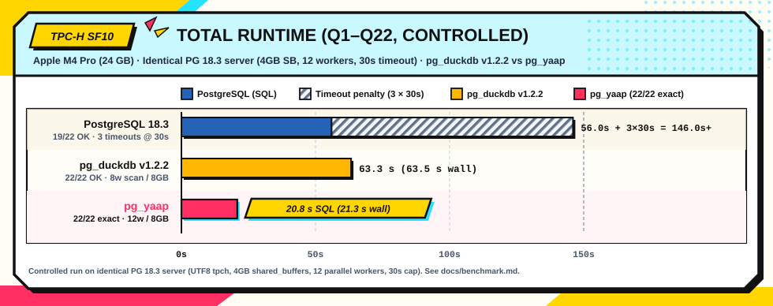
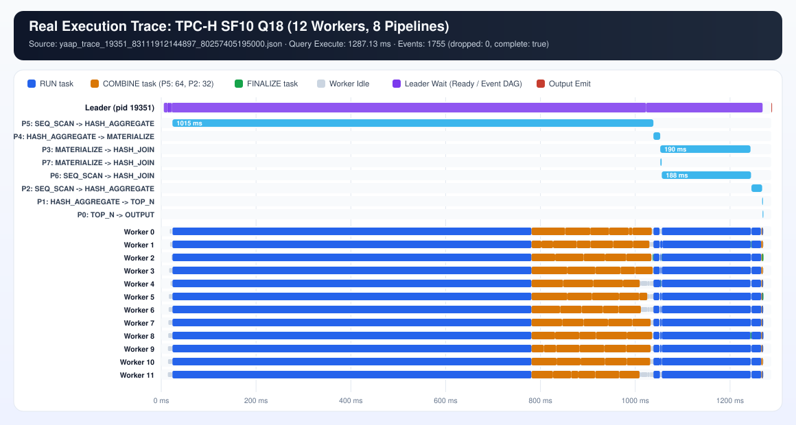

# pg_yaap

<p align="center">
  
</p>

<p align="center">
  <strong>Modern OLAP. Native PostgreSQL Storage.</strong><br/>
  A PostgreSQL extension with its own query optimizer and vectorized execution engine, built for analytical workloads on native PostgreSQL storage.
</p>

<p align="center">
  <a href="https://github.com/yuuch/pg_yaap/actions/workflows/pg_yaap-ci.yml"></a>
  
  <a href="LICENSE"></a>
  
</p>

<p align="center">
  <a href="README.zh.md">中文</a> ·
  <a href="#overview">Overview</a> ·
  <a href="#key-features">Key Features</a> ·
  <a href="#architecture">Architecture</a> ·
  <a href="#benchmark">Benchmark</a> ·
  <a href="#execution-in-action">Execution in Action</a> ·
  <a href="#build--quick-start">Quick Start</a> ·
  <a href="#status--limitations">Limitations</a> ·
  <a href="#documentation">Documentation</a>
</p>

<p align="center">
  <picture>
    <source
      media="(prefers-color-scheme: dark)"
      srcset="imgs/benchmark_snapshot_dark.svg"
    />
    <source
      media="(prefers-color-scheme: light)"
      srcset="imgs/benchmark_snapshot_light.svg"
    />
    
  </picture>
</p>

<p align="center">
  <sub>
    <a href="#benchmark">Benchmark methodology and detailed results</a>
  </sub>
</p>

## Overview

`pg_yaap` (Yet Another Analytic Processing) accelerates analytical queries inside PostgreSQL using its own optimizer, vectorized engine, and multi-process pipeline runtime — without forking PostgreSQL or changing its storage format.

PostgreSQL retains parsing, catalogs, native heap storage, MVCC, and client protocol; YAAP takes over optimization and execution for admitted analytical queries.

## Key Features

- **Independent Query Optimizer:** Subquery decorrelation, common subplan / CTE reuse, predicate pushdown, and cost-based DP join ordering ([details](docs/pipeline_runtime.md)).
- **Vectorized Execution:** Columnar `DataChunk` batches, vectorized expression evaluation, and zero-copy in-place filtering/projection ([details](docs/pipeline_runtime.md)).
- **Parallel Pipeline Runtime:** Event DAG (`RUN / COMBINE / FINALIZE`) scheduling across dynamic background workers via shared memory ([details](docs/pipeline_runtime.md)).
- **Optimized Analytical Operators:** Adaptive radix-partitioned Hybrid Hash Join, runtime Bloom filters, and hash / perfect-hash aggregation ([details](docs/hybrid_hash_join.md)).
- **Larger-than-memory Execution:** Memory-aware pipeline breakers, partitioning, recursive repartitioning, and disk spilling ([details](docs/dsa_memory_limits.md)).
- **Native Heap Scan Optimization:** PostgreSQL `ReadStream` prefetching and LLVM JIT tuple deformation ([details](docs/yaap_read_stream.md)).
- **Built-in Execution Tracing:** Lock-free per-process timelines exported to Chrome Trace / Perfetto JSON ([details](docs/execution_trace.md)).

## Architecture


1. **Query Optimization:** The planner hook routes admitted analytical `SELECT` queries through YAAP's logical and physical optimizer.
2. **Pipeline Construction:** The executor hook splits the physical plan at blocking operators into Event DAG pipelines in shared memory.
3. **Parallel Execution:** A Leader coordinates workers scanning native heap tables and processing vectorized batches.
4. **Result Delivery:** Output batches materialize back into PostgreSQL tuple slots via the native protocol.

Scheduler details and worker coordination: [docs/pipeline_runtime.md](docs/pipeline_runtime.md).

## Benchmark

Controlled runs on **Apple M4 Pro (14 cores, 24 GB RAM)** sharing the **same PostgreSQL 18.3 server configuration** (`UTF8` heap tables, `shared_buffers=4GB`, `max_parallel_workers=12`, worker AIO, no secondary indexes; full setups and per-query tables in [docs/benchmark.md](docs/benchmark.md)):

| Scale | Engine | Completed | Timeout / Fail | SQL Time (Completed) | Total (Timeout = Cap) | Setup / Policy |
|---|---|---:|---:|---:|---:|---|
| **SF10** | `pg_yaap` | **22 / 22** | 0 | **20.8 s** | **20.8 s** | `21.3 s` wall, 12 workers, `8GB` `memory_limit`, `30 s` cap |
| **SF10** | `pg_duckdb v1.2.2` | **22 / 22** | 0 | 63.3 s | 63.3 s | DuckDB `v2.0.1`, `8GB`, `8` PG scan workers / `2` threads, `30 s` cap |
| **SF10** | PostgreSQL `18.3` | 19 / 22 | 3 TO | 56.0 s | 146.0 s+ | Native parallel (`12` workers); Q2, Q17, Q20 counted as `30 s` (`3 × 30 s`) |
| **SF100** | `pg_yaap` | **22 / 22** | 0 | **432.6 s** | **432.6 s** | ~125 GB DB, 12 workers, `8GB`, `100 s` cap; **22/22 exact match** (`1.64×` vs DuckDB) |
| **SF100** | `pg_duckdb v1.2.2` | **22 / 22** | 0 | 710.2 s | 710.2 s | DuckDB `v2.0.1`, `8GB`, `8` PG scan workers / `2` threads, `100 s` cap |
| **SF100** | PostgreSQL `18.3` | 16 / 22 | 6 TO | 501.4 s | 1,101.4 s+ | Native parallel (`12` workers); Q2, Q9, Q17, Q18, Q20, Q21 counted as `100 s` (`6 × 100 s`) |

Timed-out queries are billed at the `statement_timeout` cap (`30 s` at SF10, `100 s` at SF100), with `+` marking lower-bound totals. `pg_yaap.memory_limit` caps shared breaker payloads in DSA rather than process RSS or `shared_buffers` ([docs/dsa_memory_limits.md](docs/dsa_memory_limits.md)).




## Execution in Action

Real trace of TPC-H SF10 Q18 captured by YAAP's tracing system: **12 workers**, **8 pipelines**, **`1.287 s` query time**, **`0` dropped events**, and `RUN / COMBINE / FINALIZE` stages across parallel workers.



Raw trace JSON: [docs/tpch_sf10_q18_trace.json](docs/tpch_sf10_q18_trace.json) · Stage walkthrough and trace usage: [docs/execution_trace.md](docs/execution_trace.md)

## Build & Quick Start

Requires **PostgreSQL 18.x** (`18.3` tested, server headers and `pg_config`; `-Dllvm=enabled` recommended), **C++17**, **Meson**, **Ninja**, and matching **LLVM**:

```bash
meson setup build -Dpg_config=/path/to/pg_config -Dbuildtype=release
meson compile -C build
meson install -C build
```

Offline Linux builds: [docs/offline-linux-build.md](docs/offline-linux-build.md).

### Standalone Quick Start

Use a regular persistent table (`TEMP TABLE` buffers are invisible to parallel workers):

```sql
LOAD 'pg_yaap';

CREATE TABLE orders_demo (o_orderkey bigint, o_region char(1), o_totalprice numeric(15,2), o_orderdate date);
INSERT INTO orders_demo
SELECT i, CASE i % 4 WHEN 0 THEN 'N' WHEN 1 THEN 'S' WHEN 2 THEN 'E' ELSE 'W' END,
       ((i % 1000) * 1.25)::numeric(15,2), date '2024-01-01' + (i % 365)
FROM generate_series(1, 200000) AS i;
ANALYZE orders_demo;

SET pg_yaap.enabled = on;
SET pg_yaap.parallel = on;
SET pg_yaap.parallel_max_workers = 4;

-- Confirm planner takeover (rows are optimizer estimates):
EXPLAIN
SELECT o_region, count(*) AS order_cnt, sum(o_totalprice) AS total_revenue
FROM orders_demo
WHERE o_orderdate >= date '2024-07-01'
GROUP BY o_region
ORDER BY o_region;

-- Execute via YAAP; server LOG emits "pg_yaap_path: path=pipeline detail=yaap_pipeline":
SET pg_yaap.trace_execution_path = on;
SELECT o_region, count(*) AS order_cnt, sum(o_totalprice) AS total_revenue
FROM orders_demo
WHERE o_orderdate >= date '2024-07-01'
GROUP BY o_region
ORDER BY o_region;

-- Switch back to native PostgreSQL:
SET pg_yaap.enabled = off;
```

Example `EXPLAIN` output (`rows` are optimizer estimates):

```text
 Planner: YAAP optimizer
 YAAP Physical Plan: 
 ORDER_BY [rows=4, keys=1]
 `- PROJECTION [rows=4, exprs=3]
    `- HASH_GROUP_BY [rows=4, groups=1, aggs=2]
       |- PROJECTION [rows=40000, exprs=2]
       |  `- TABLE_SCAN [rows=40000, table=orders_demo, filters=1]
```

### Common Configuration

| GUC | Default | Description |
|---|---|---|
| `pg_yaap.enabled` | `on` | Enable YAAP |
| `pg_yaap.parallel` | `on` | Enable parallel execution |
| `pg_yaap.parallel_max_workers` | `4` | Max workers per query |
| `pg_yaap.memory_limit` | `256MB` | Shared operator payload budget (`MB`, `>= 64MB`) |

Full GUC reference: [docs/configuration.md](docs/configuration.md).

## Status & Limitations

`pg_yaap` is an **experimental extension**—not a storage engine, OLTP accelerator, or PostgreSQL fork.

- **Supported:** Analytical `SELECT` over native heap tables (`INNER`/`LEFT`/`RIGHT`/`SEMI`/`ANTI`/`MARK`/`SINGLE` joins, cross products, subquery decorrelation, CTE reuse, hash/perfect-hash aggregation, top-N, sort, filter, projection).
- **Numeric precision:** Hot scan and expression paths encode `NUMERIC` as scaled `int64` with automatic runtime promotion to 128-bit (`__int128`) on expression overflow and 128-bit `SUM`/`AVG` accumulators (up to 38 digits); arbitrary-precision `NUMERIC` beyond 128-bit or `NaN`/`Infinity` is not supported.
- **Execution limits:** Single-threaded final `ORDER BY`, per-query worker spawning (no worker pool), and no `TEMP TABLE` worker access.
- **Unsupported:** `FULL OUTER` join, `DISTINCT`, window functions, set operations (`UNION`/`INTERSECT`/`EXCEPT`), `EXPLAIN ANALYZE`, special cursors (`SCROLL`/`HOLD`/`BACKWARD`/`REWIND`/`MARK`), and DML.
- **No silent fallback:** Before admission, non-`SELECT`, DDL, unsupported cursors, `pg_yaap.enabled = off`, and unsupported shapes stay on PostgreSQL. Once registered, runtime failures raise `ereport(ERROR)` instead of falling back silently.

## Testing

```bash
meson test -C build --print-errorlogs
```

Python suite, environment variables, and CI details: [docs/testing.md](docs/testing.md).

## Documentation

- **Architecture & Optimizer:** [AGENTS.md](AGENTS.md) · [src/optimizer/](src/optimizer) · [pg_yaap_executor_design.md](pg_yaap_executor_design.md) · [Gap Analysis](docs/executor_architecture_gap_analysis.md)
- **Runtime & Operators:** [Pipeline Runtime](docs/pipeline_runtime.md) ([diagram](imgs/pipeline_runtime.svg)) · [Hybrid Hash Join](docs/hybrid_hash_join.md) · [Partition Probe](docs/hash_join_partition_probe.md) · [DSA Memory Limits](docs/dsa_memory_limits.md) · [ReadStream](docs/yaap_read_stream.md)
- **Usage & Validation:** [Configuration](docs/configuration.md) · [Benchmarks](docs/benchmark.md) · [Execution Tracing](docs/execution_trace.md) · [Testing](docs/testing.md) · [Offline Linux Build](docs/offline-linux-build.md)

## Acknowledgements & License

Thanks to **PostgreSQL** for its hooks and storage/IPC infrastructure, and to **DuckDB** for optimization and vectorized execution inspiration. Licensed under **Apache License 2.0** ([LICENSE](LICENSE)).
