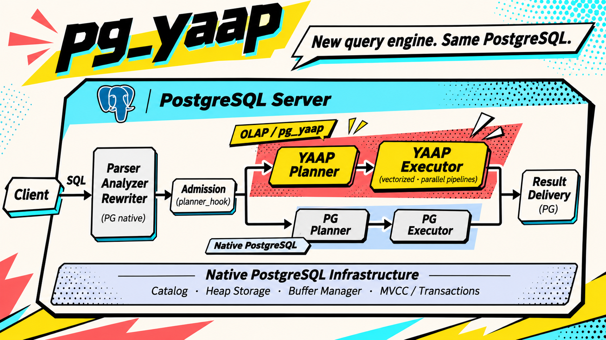
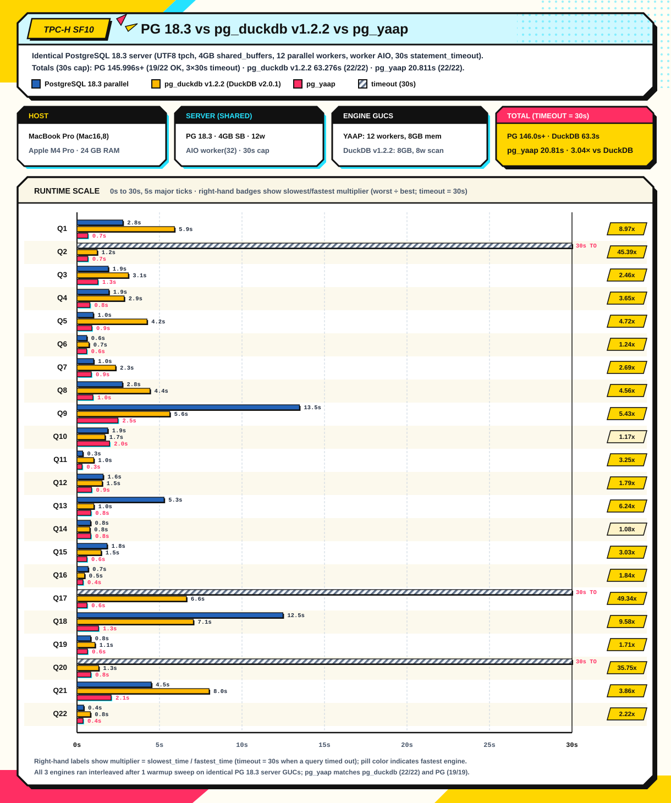
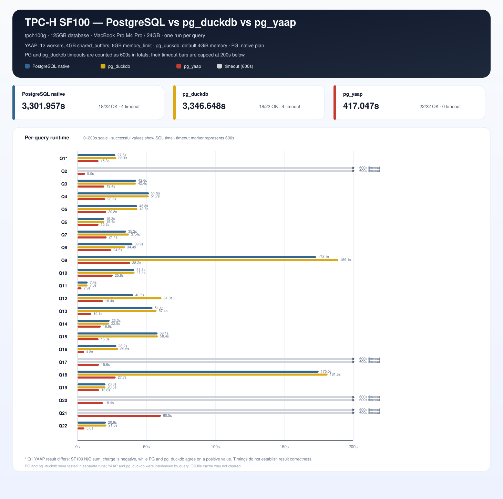

# pg_yaap — Yet Another Analytic Processing

<p align="center">
  
</p>

<p align="center">
  <strong>A YAAP-owned analytical optimizer and C++ columnar execution engine running inside PostgreSQL.</strong>
</p>

<p align="center">
  <a href="https://github.com/yuuch/pg_yaap/actions/workflows/pg_yaap-ci.yml"></a>
  <a href="README.zh.md">中文文档</a>
  ·
  <a href="#architecture">Architecture</a>
  ·
  <a href="#tpc-h-benchmark">TPC-H Benchmark</a>
  ·
  <a href="#build">Build</a>
  ·
  <a href="#quick-start">Quick Start</a>
  ·
  <a href="#documentation">Docs</a>
  ·
  <a href="LICENSE">License</a>
</p>

---

## Overview

`pg_yaap` is a PostgreSQL extension that intercepts supported analytical queries and runs them through a dedicated C++ optimizer and vectorized columnar execution engine — **without forking PostgreSQL**.

PostgreSQL remains the system of record and handles:
- SQL parsing, catalog metadata, and transaction/MVCC semantics
- Storage, Buffer Manager, and `ReadStream` I/O
- Wire protocol and tuple slot delivery to clients

`pg_yaap` takes over the analytical hot path:
- **YAAP-owned optimizer**: DuckDB-inspired logical planning, subquery decorrelation, CSE/CTE reuse, filter/predicate pushdown, and DP join-order optimization.
- **Columnar execution engine**: Fixed-size `DataChunk` batch processing and vectorized expression evaluation instead of tuple-at-a-time volcano execution.
- **LLVM JIT tuple deformation**: Optional JIT-compiled heap tuple decoding directly into columnar buffers (`pg_yaap.jit_deform`).
- **Parallel Event DAG pipelines**: Multi-process background worker execution with pipeline breakers, adaptive radix-partitioned Hybrid Hash Join, runtime Bloom filter pushdown, hash/perfect-hash aggregation, and bounded-memory spill-to-disk.
- **Built-in execution tracing**: Lightweight per-process Chrome Trace / Perfetto JSON export (`pg_yaap.trace_enabled`) for diagnosing worker timelines without external OS profilers.
- **No silent fallback**: Once YAAP claims a query, it executes it end-to-end or fails loudly — never masking bugs or regressions by silently falling back to the PostgreSQL executor.

---

## Architecture



1. `planner_hook` translates supported `Query` trees into YAAP's logical and physical plans (`PhysicalOperator`).
2. `ExecutorStart` and `ExecutorRun` lower admitted plans into the parallel pipeline runtime via the bridge layer.
3. Leader and background workers execute `DataChunk` batches across parallel pipelines scheduled over an Event DAG.
4. Final results are materialized back into PostgreSQL `TupleTableSlot`s through standard tuple output interfaces.

See [docs/pipeline_runtime.md](docs/pipeline_runtime.md) for task scheduling, shared-state ownership, process synchronization, and current runtime limits.

---

## TPC-H Benchmark

Snapshots below were measured on an **Apple M4 Pro (24 GB RAM)** with `pg_yaap` configured at `shared_buffers=4GB`, `12` parallel workers, and `pg_yaap.memory_limit=8GB`, compared against baseline `PostgreSQL` and `pg_duckdb` runs.

| Scale | Engine | Passed / Total | SQL Time | Wall Time | Notes |
|---|---|---|---|---|---|
| **SF10** | `pg_yaap` | **22 / 22** | **20.5 s** | **21.4 s** | `shared_buffers=4GB`, 12 workers, `memory_limit=8GB` |
| **SF10** | `pg_duckdb` | 22 / 22 | 95.8 s | — | Baseline run |
| **SF10** | PostgreSQL | 22 / 22 | 447.9 s | — | Baseline run |
| **SF100** | `pg_yaap` | **22 / 22** | **414.5 s** | **425.3 s** | `shared_buffers=4GB`, 12 workers, `memory_limit=8GB`, 0 timeouts |
| **SF100** | PostgreSQL | 18 / 22 | 3,302.0 s | — | `shared_buffers=2GB` baseline; 4 timeouts (600 s each in total) |
| **SF100** | `pg_duckdb` | 18 / 22 | 3,346.6 s | — | `shared_buffers=2GB` baseline, default 4 GiB memory; 4 timeouts (600 s each) |

### SF10 (10 GB)



### SF100 (100 GB)



`tpch100g` occupies ~125 GB on disk on the 24 GB M4 Pro test machine. Treat both charts as hardware- and configuration-specific snapshots rather than universal claims.

> **Correctness note:** In SF100 Q1, YAAP's `N|O` group `sum_charge` differs from PostgreSQL and `pg_duckdb` (YAAP returns a negative value due to scaled integer overflow while PostgreSQL and `pg_duckdb` return a positive value). Runtime charts compare execution speed and do not imply identical numeric output on that query.

---

## Build

### Prerequisites

- **PostgreSQL 18.x** development installation (`pg_config` in `PATH` or specified explicitly; built with `-Dllvm=enabled` recommended for JIT tuple deformation)
- **C++17** compiler (Clang or GCC)
- **Meson** and **Ninja**
- **LLVM** toolchain matching PostgreSQL (optional, enabled automatically when PostgreSQL has `USE_LLVM`)

### Build with Meson

```bash
meson setup build -Dpg_config=/path/to/pg_config -Dbuildtype=release
meson compile -C build
meson install -C build
```

### Helper Scripts & Offline Linux Build

Helper scripts in `scripts/` automate extension installation and offline source packaging:

```bash
# Build and install against an existing pg_config
./scripts/build_install.sh --pg-config /path/to/pg_config

# Create a source-only offline tarball (including PostgreSQL + pg_yaap), then build from source
./scripts/make_offline_bundle.sh --output /path/to/pg_yaap-offline.tar.gz
./pg_yaap/scripts/build_postgres_and_yaap.sh --prefix "$HOME/pgsql-yaap"
```

See [docs/offline-linux-build.md](docs/offline-linux-build.md) for offline Linux dependency details and instructions.

---

## Quick Start

Load the extension in a session (or add `pg_yaap` to `shared_preload_libraries`):

```sql
LOAD 'pg_yaap';
SET pg_yaap.enabled = on;
SET pg_yaap.parallel = on;
SET pg_yaap.parallel_max_workers = 4;

SELECT
    l_returnflag,
    l_linestatus,
    sum(l_quantity) AS sum_qty,
    sum(l_extendedprice) AS sum_base_price
FROM lineitem
GROUP BY l_returnflag, l_linestatus
ORDER BY l_returnflag, l_linestatus;
```

### Key GUCs

| GUC | Default | Description |
|---|---|---|
| `pg_yaap.enabled` | `on` | Master switch for planner/executor hooks |
| `pg_yaap.parallel` | `on` | Enables parallel pipeline execution |
| `pg_yaap.parallel_max_workers` | `4` | Maximum background workers per query (`0`–`1024`) |
| `pg_yaap.parallel_min_relation_blocks` | `1024` | Minimum relation blocks before parallel lowering is considered |
| `pg_yaap.jit_deform` | `on` | Enables LLVM JIT tuple deformation |
| `pg_yaap.hash_join_partition_probe` | `on` | Enables partition-paired Hybrid Hash Join probing |
| `pg_yaap.memory_limit` | `256MB` | Shared memory budget for pipeline breakers (`>= 64MB`) |
| `pg_yaap.memory_soft_limit` | `-1` | Soft spill threshold in MB (`-1` uses 75% of `memory_limit`) |
| `pg_yaap.dsa_memory_limit` | `-1` | Max DSA segment capacity in MB (`-1` for automatic headroom) |
| `pg_yaap.trace_enabled` | `off` | Records lightweight per-process Execution Trace events |
| `pg_yaap.trace_output_dir` | `""` | Superuser-only absolute directory for exported Perfetto JSON traces |

---

## Testing

### C++ Unit Tests

```bash
meson test -C build --print-errorlogs
```

### Python Integration Suites

The Python test suites in `tests/` require only the Python standard library and `psql` against a running PostgreSQL server (start PostgreSQL with `-c max_worker_processes=32 -c max_parallel_workers=12` for 12-worker cases):

```bash
export PSQL=/path/to/psql
export YAAP_LIBRARY=/path/to/pg_yaap.so   # or .dylib on macOS
export PGHOST=/tmp PGPORT=55432 PGUSER=postgres PGDATABASE=postgres

python3 tests/hybrid_hash_join.py
python3 tests/right_outer_hash_join.py
python3 tests/memory_runtime.py
python3 tests/pipeline_scheduling.py
python3 tests/pipeline_stage_plans.py
python3 tests/execution_trace.py --abnormal
```

---

## Scope

**Good fit:**
- Scan-heavy OLAP queries and TPC-H-style analytical workloads
- Modern optimizer and vectorized/pipeline execution experiments inside PostgreSQL

**Non-goals:**
- Replacing PostgreSQL storage, parser, catalog, or transaction engine
- Maintaining a standalone PostgreSQL fork
- General OLTP acceleration
- Silently falling back to mask unsupported execution paths

---

## Documentation

- [Pipeline Runtime & Process Communication](docs/pipeline_runtime.md)
- [Execution Trace (Layer 1 Perfetto Export)](docs/execution_trace.md)
- [Hybrid Radix Hash Join](docs/hybrid_hash_join.md) & [Partition-Pair Probe](docs/hash_join_partition_probe.md)
- [DSA Memory Limits](docs/dsa_memory_limits.md)
- [Physical SeqScan ReadStream](docs/yaap_read_stream.md)
- [Offline Linux Build Guide](docs/offline-linux-build.md)

---

## Acknowledgements

Thanks to the PostgreSQL project for its hook architecture, extension ecosystem, and storage/runtime foundation, and to DuckDB for inspiring many ideas around optimizer structure, vectorized execution, and columnar analytical processing.

---

## License

Apache License 2.0 — see [LICENSE](LICENSE).
