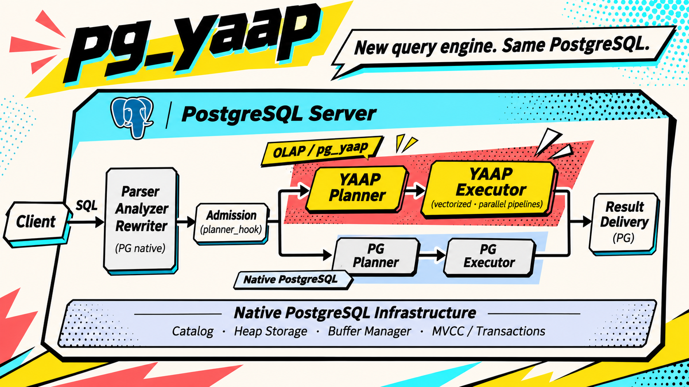
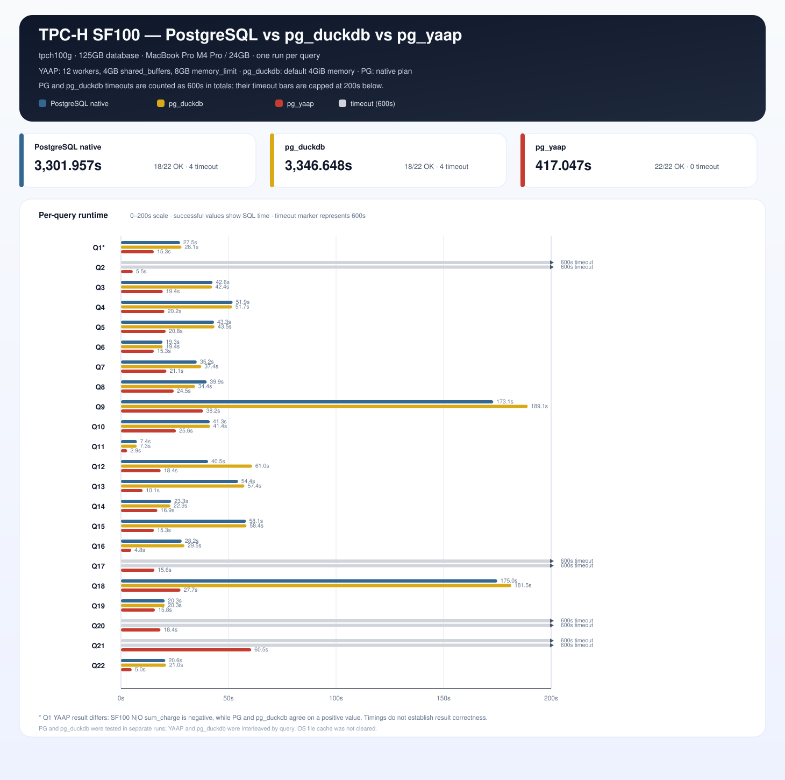

# pg_yaap — Yet Another Analytic Processing

<p align="center">
  
</p>

<p align="center">
  <strong>把现代 OLAP 优化器和 C++ 列式执行引擎带进 PostgreSQL。</strong>
</p>

<p align="center">
  <a href="https://github.com/yuuch/pg_yaap/actions/workflows/pg_yaap-ci.yml"></a>
  <a href="README.md">English</a>
  ·
  <a href="#架构">架构</a>
  ·
  <a href="#tpc-h-基准快照">TPC-H Benchmark</a>
  ·
  <a href="#构建">构建</a>
  ·
  <a href="#快速开始">快速开始</a>
  ·
  <a href="#相关文档">文档</a>
  ·
  <a href="LICENSE">License</a>
</p>

---

## 概览

`pg_yaap` 是一个 PostgreSQL 扩展。它在不 fork PostgreSQL 内核的前提下，为支持的分析型查询接入一套独立的 C++ 优化器与向量化列式执行引擎。

PostgreSQL 依然是数据库主体，继续负责：
- SQL 解析、Catalog 元数据与事务 / MVCC 语义
- 存储引擎、Buffer Manager 与 `ReadStream` I/O
- 客户端连接协议与结果返回接口

`pg_yaap` 接管分析型查询的核心热路径：
- **YAAP 自有优化器**：参考 DuckDB 的逻辑规划、子查询去相关（decorrelation）、CSE/CTE 复用、谓词下推以及基于 DP 的 Join 重排序。
- **列式执行引擎**：以固定大小的 `DataChunk` 批次为单位执行与表达式求值，替代传统的逐 tuple 火山模型。
- **LLVM JIT 元组解码**：可选通过 LLVM JIT 将 PostgreSQL 堆元组直接解码为列式内存布局（`pg_yaap.jit_deform`）。
- **基于 Event DAG 的并行 Pipeline**：多后台进程（bgworker）协同执行，支持自适应 radix 分区 Hybrid Hash Join、Runtime Bloom Filter 下推、Hash / Perfect-Hash 聚合以及有界内存落盘（spill-to-disk）。
- **内建执行追踪**：支持轻量化导出 Perfetto / Chrome Trace JSON（`pg_yaap.trace_enabled`），无需系统级 root/dtrace/perf 权限即可定位多进程瓶颈。
- **不做静默 fallback**：YAAP 一旦声明接管查询，就会完整执行或明确报错暴露问题，不会用静默回退掩盖正确性或性能缺陷。

---

## 架构



1. `planner_hook` 将支持的 `Query` 树转换为 YAAP 的逻辑与物理计划（`PhysicalOperator`）。
2. `ExecutorStart` 与 `ExecutorRun` 通过桥接层将已接管的物理计划下发至并行 pipeline 运行时。
3. Leader 与多个后台 worker 按 Event DAG 调度并执行列式 `DataChunk` 数据流。
4. 最终结果转换回 PostgreSQL 标准的 `TupleTableSlot` 并返回给客户端。

任务调度、共享状态归属、进程间同步及当前限制详见 [docs/pipeline_runtime.md](docs/pipeline_runtime.md)。

---

## TPC-H 基准快照

以下快照测试运行于 **Apple M4 Pro（24 GB 内存）**，`pg_yaap` 配置为 `shared_buffers=4GB`、12 workers、`pg_yaap.memory_limit=8GB`，并与基线下的原生 PostgreSQL 及 `pg_duckdb` 对比：

| 数据规模 | 引擎 | 通过 / 总数 | SQL 耗时 | 墙钟耗时 | 备注与配置 |
|---|---|---|---|---|---|
| **SF10** | `pg_yaap` | **22 / 22** | **20.5 s** | **21.4 s** | `shared_buffers=4GB`，12 workers，`memory_limit=8GB` |
| **SF10** | `pg_duckdb` | 22 / 22 | 95.8 s | — | 基线对比测试 |
| **SF10** | PostgreSQL | 22 / 22 | 447.9 s | — | 基线对比测试 |
| **SF100** | `pg_yaap` | **22 / 22** | **414.5 s** | **425.3 s** | `shared_buffers=4GB`，12 workers，`memory_limit=8GB`，0 超时 |
| **SF100** | PostgreSQL | 18 / 22 | 3,302.0 s | — | `shared_buffers=2GB` 基线；4 条超时（每条按 600 s 计） |
| **SF100** | `pg_duckdb` | 18 / 22 | 3,346.6 s | — | `shared_buffers=2GB` 基线，默认 4 GiB 内存；4 条超时（每条 600 s） |

### SF10（10 GB）


### SF100（100 GB）



测试机上的 `tpch100g` 数据库磁盘占用约 125 GB。以上数据仅作为当前阶段在特定硬件与配置下的性能快照。

> **正确性说明：**在 SF100 Q1 中，YAAP 输出的 `N|O` 分组 `sum_charge` 与 PostgreSQL 和 `pg_duckdb` 不一致（YAAP 因定标整数溢出返回负数，另外两者返回正数）。图表仅比较查询耗时，不代表该查询数值结果完全一致。

---

## 构建

### 环境要求

- **PostgreSQL 18.x** 开发环境（`pg_config` 在 `PATH` 中或显式指定；建议 PostgreSQL 启用 `-Dllvm=enabled` 以开启 JIT 解码）
- **C++17** 编译器（Clang 或 GCC）
- **Meson** 与 **Ninja**
- 与 PostgreSQL 对应的 **LLVM** 工具链（可选，当 PostgreSQL 启用 `USE_LLVM` 时自动启用）

### 使用 Meson 构建

```bash
meson setup build -Dpg_config=/path/to/pg_config -Dbuildtype=release
meson compile -C build
meson install -C build
```

### 辅助脚本与离线 Linux 构建

`scripts/` 目录提供了扩展安装以及全量离线源码打包构建脚本：

```bash
# 针对已有 pg_config 一键构建并安装扩展
./scripts/build_install.sh --pg-config /path/to/pg_config

# 制作仅包含源码（PostgreSQL + pg_yaap）的离线包，并在目标机器构建
./scripts/make_offline_bundle.sh --output /path/to/pg_yaap-offline.tar.gz
./pg_yaap/scripts/build_postgres_and_yaap.sh --prefix "$HOME/pgsql-yaap"
```

离线环境依赖、LLVM 与 PostgreSQL 构建说明详见 [docs/offline-linux-build.md](docs/offline-linux-build.md)。

---

## 快速开始

在会话中加载扩展（或将 `pg_yaap` 加入 `shared_preload_libraries`）：

```sql
LOAD 'pg_yaap';
SET pg_yaap.enabled = on;
SET pg_yaap.parallel = on;
SET pg_yaap.parallel_max_workers = 4;

SELECT
    l_returnflag,
    l_linestatus,
    sum(l_quantity) AS sum_qty,
    sum(l_extendedprice) AS sum_base_price
FROM lineitem
GROUP BY l_returnflag, l_linestatus
ORDER BY l_returnflag, l_linestatus;
```

### 常用配置项（GUCs）

| 参数名 | 默认值 | 说明 |
|---|---|---|
| `pg_yaap.enabled` | `on` | 接管 planner / executor hook 的总开关 |
| `pg_yaap.parallel` | `on` | 开启并行 pipeline 执行路径 |
| `pg_yaap.parallel_max_workers` | `4` | 单查询最大后台 worker 数（`0`–`1024`） |
| `pg_yaap.parallel_min_relation_blocks` | `1024` | 启用并行执行所需的最小表块数阈值 |
| `pg_yaap.jit_deform` | `on` | 开启 LLVM JIT 元组解码 |
| `pg_yaap.hash_join_partition_probe` | `on` | 开启按分区对执行的 Hybrid Hash Join |
| `pg_yaap.memory_limit` | `256MB` | pipeline breaker 共享内存硬预算（`>= 64MB`） |
| `pg_yaap.memory_soft_limit` | `-1` | 触发算子落盘的软阈值 MB（`-1` 为硬上限的 75%） |
| `pg_yaap.dsa_memory_limit` | `-1` | 查询 DSA 段总容量上限 MB（`-1` 为自动预留元数据余量） |
| `pg_yaap.trace_enabled` | `off` | 开启轻量级每进程 Execution Trace 记录 |
| `pg_yaap.trace_output_dir` | `""` | 导出 Perfetto JSON 的服务端绝对目录（仅超级用户可设） |

---

## 测试

### C++ 单元测试

```bash
meson test -C build --print-errorlogs
```

### Python 集成测试

`tests/` 下的集成测试仅依赖 Python 标准库和 `psql`。运行前请先启动 PostgreSQL（因为用例会测到 12 workers，启动时建议配置 `-c max_worker_processes=32 -c max_parallel_workers=12`）：

```bash
export PSQL=/path/to/psql
export YAAP_LIBRARY=/path/to/pg_yaap.so   # macOS 下为 .dylib
export PGHOST=/tmp PGPORT=55432 PGUSER=postgres PGDATABASE=postgres

python3 tests/hybrid_hash_join.py
python3 tests/right_outer_hash_join.py
python3 tests/memory_runtime.py
python3 tests/pipeline_scheduling.py
python3 tests/pipeline_stage_plans.py
python3 tests/execution_trace.py --abnormal
```

---

## 项目定位

**适合的场景：**
- 重扫描（scan-heavy）的 OLAP 查询与 TPC-H 风格分析型负载
- PostgreSQL 内部的现代优化器、列式向量化与并行 pipeline 执行实验

**不追求的目标：**
- 替换 PostgreSQL 存储引擎、parser、catalog 或事务体系
- 维护一个独立的 PostgreSQL fork
- 通用 OLTP 场景加速
- 用静默 fallback 掩盖不支持的执行路径

---

## 相关文档

- [Pipeline 运行时与进程通信](docs/pipeline_runtime.md)
- [Execution Trace（Layer 1 Perfetto 导出）](docs/execution_trace.md)
- [Hybrid Radix Hash Join](docs/hybrid_hash_join.md) 与 [分区对 Probe](docs/hash_join_partition_probe.md)
- [DSA 内存上限语义](docs/dsa_memory_limits.md)
- [Physical SeqScan ReadStream](docs/yaap_read_stream.md)
- [离线 Linux 构建指南](docs/offline-linux-build.md)

---

## 致谢

感谢 PostgreSQL 社区提供的 hook 架构、扩展生态和长期沉淀的数据库工程基础，也感谢 DuckDB 在优化器架构、向量化执行与列式分析处理上带来的灵感。

---

## License

Apache License 2.0 — 详见 [LICENSE](LICENSE)。
