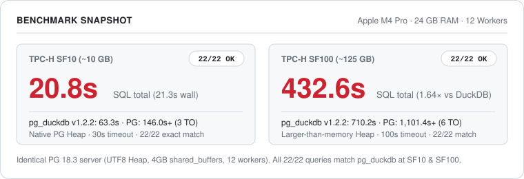
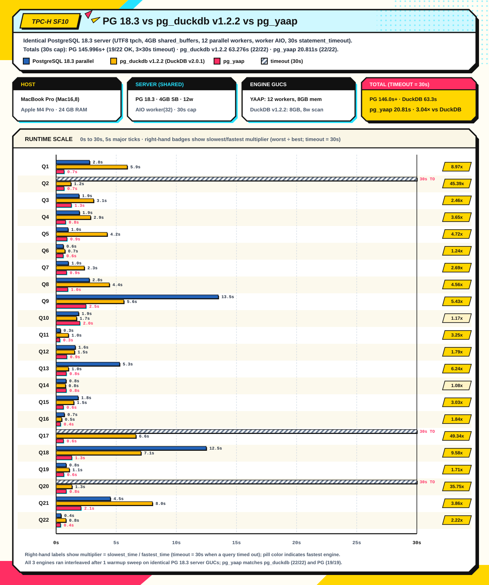

# pg_yaap

<p align="center">
  
</p>

<p align="center">
  <strong>Modern OLAP. Native PostgreSQL Storage.</strong><br/>
  一个基于 PostgreSQL 原生存储构建的扩展：自带查询优化器与向量化执行引擎，专注分析型工作负载。
</p>

<p align="center">
  <a href="https://github.com/yuuch/pg_yaap/actions/workflows/pg_yaap-ci.yml"></a>
  
  <a href="LICENSE"></a>
  
</p>

<p align="center">
  <a href="README.md">English</a> ·
  <a href="#概览">概览</a> ·
  <a href="#核心特性">核心特性</a> ·
  <a href="#系统架构">系统架构</a> ·
  <a href="#基准测试">基准测试</a> ·
  <a href="#execution-in-action">运行追踪</a> ·
  <a href="#构建与快速开始">快速开始</a> ·
  <a href="#状态与限制">状态与限制</a> ·
  <a href="#文档导航">文档导航</a>
</p>

<p align="center">
  <picture>
    <source
      media="(prefers-color-scheme: dark)"
      srcset="imgs/benchmark_snapshot_dark.svg"
    />
    <source
      media="(prefers-color-scheme: light)"
      srcset="imgs/benchmark_snapshot_light.svg"
    />
    
  </picture>
</p>

<p align="center">
  <sub>
    <a href="#基准测试">查看 Benchmark 测试方法与完整结果</a>
  </sub>
</p>

## 概览

`pg_yaap`（Yet Another Analytic Processing）在保持 PostgreSQL 原生存储与事务架构不变的前提下，通过自研优化器、向量化引擎及多进程 Pipeline 运行时加速分析查询，无需 Fork PostgreSQL。

PostgreSQL 保留解析、Catalog、原生堆表存储、MVCC 与客户端协议；YAAP 接管受支持分析查询的优化与执行。

## 核心特性

- **独立查询优化器：** 子查询去相关、公共子计划 / CTE 复用、谓词下推与基于代价的 DP Join 重排序（[详见](docs/pipeline_runtime.md)）。
- **向量化执行：** 列式 `DataChunk` 批次、向量化表达式求值，支持零拷贝原地过滤与投影（[详见](docs/pipeline_runtime.md)）。
- **并行 Pipeline 运行时：** 基于 Event DAG 调度 `RUN / COMBINE / FINALIZE`，由动态 worker 与共享内存协同执行（[详见](docs/pipeline_runtime.md)）。
- **优化的分析算子：** 自适应 Radix 分区 Hybrid Hash Join、Runtime Bloom Filter 与 Hash / Perfect-Hash 聚合（[详见](docs/pipeline_runtime.md)）。
- **超内存执行：** 内存感知阻塞算子、分区处理、递归再分区与磁盘落盘（[详见](docs/configuration.md)）。
- **原生堆表扫描优化：** PostgreSQL `ReadStream` 预取集成与 LLVM JIT 元组解码（[详见](docs/pipeline_runtime.md)）。
- **内置执行追踪：** 无锁采集每进程时间线并导出 Chrome Trace / Perfetto JSON（[详见](docs/execution_trace.md)）。

## 系统架构


1. **查询优化：** Planner Hook 将受支持分析型 `SELECT` 路由至 YAAP 逻辑与物理优化器。
2. **Pipeline 构建：** Executor Hook 按阻塞算子将计划拆分为共享内存支撑的 Event DAG Pipeline。
3. **并行执行：** Leader 协调 worker 扫描原生堆表并推进向量化批次。
4. **结果返回：** 输出批次物化回 PostgreSQL 元组槽位并经原生协议返回。

调度细节与 worker 协同见 [docs/pipeline_runtime.md](docs/pipeline_runtime.md)。

## 基准测试

测试于 **Apple M4 Pro（14 核，24 GB 内存）** 执行，三套引擎共用**同一套 PostgreSQL 18.3 服务端配置**（`UTF8` 原生堆表、`shared_buffers=4GB`、`max_parallel_workers=12`、worker AIO、无二级索引；完整条件与逐条数据见 [docs/benchmark.md](docs/benchmark.md)）：

| 规模 | 引擎 | 完成 | 超时 / 异常 | 已完成 SQL 耗时 | 总计（超时按上限计） | 配置与超时策略 |
|---|---|---:|---:|---:|---:|---|
| **SF10** | `pg_yaap` | **22 / 22** | 0 | **20.8 s** | **20.8 s** | 墙钟 `21.3 s`，12 workers，`8GB` `memory_limit`，`30 s` 上限 |
| **SF10** | `pg_duckdb v1.2.2` | **22 / 22** | 0 | 63.3 s | 63.3 s | DuckDB `v2.0.1`，`8GB`，`8` PG 扫描 worker / `2` 拉取线程，`30 s` 上限 |
| **SF10** | PostgreSQL `18.3` | 19 / 22 | 3 超时 | 56.0 s | 146.0 s+ | 原生并行（12 workers）；Q2、Q17、Q20 按 `30 s` 计（`3 × 30 s`） |
| **SF100** | `pg_yaap` | **22 / 22** | 0 | **432.6 s** | **432.6 s** | ~125 GB 库，12 workers，`8GB`，`100 s` 上限；**22/22 逐行一致**（较 DuckDB `1.64×`） |
| **SF100** | `pg_duckdb v1.2.2` | **22 / 22** | 0 | 710.2 s | 710.2 s | DuckDB `v2.0.1`，`8GB`，`8` PG 扫描 worker / `2` 拉取线程，`100 s` 上限 |
| **SF100** | PostgreSQL `18.3` | 16 / 22 | 6 超时 | 501.4 s | 1,101.4 s+ | 原生并行（12 workers）；Q2、Q9、Q17、Q18、Q20、Q21 按 `100 s` 计（`6 × 100 s`） |

超时查询按 `statement_timeout` 上限计入总耗时（SF10 为 `30 s`、SF100 为 `100 s`），总时间后的 `+` 表示实际耗时大于该下界；`pg_yaap.memory_limit` 限制 DSA 中共享 breaker 载荷，而非进程 RSS 或 `shared_buffers`（[docs/configuration.md](docs/configuration.md)）。





## Execution in Action

基于 YAAP 内置追踪采集的 TPC-H SF10 Q18 真实执行时间线：**12 workers**、**8 条 Pipeline**、**`1.287 s` 查询耗时**、**`0` 丢事件**及 `RUN / COMBINE / FINALIZE` 阶段。


原始 Trace：[docs/tpch_sf10_q18_trace.json](docs/tpch_sf10_q18_trace.json) · 阶段拆解与使用方法：[docs/execution_trace.md](docs/execution_trace.md)

## 构建与快速开始

需要 **PostgreSQL 18.x**（已验证 `18.3`，含服务端头文件与 `pg_config`，建议 `-Dllvm=enabled`）、**C++17**、**Meson**、**Ninja** 与对应 **LLVM**：

```bash
meson setup build -Dpg_config=/path/to/pg_config -Dbuildtype=release
meson compile -C build
meson install -C build
```

离线 Linux 构建：[docs/offline-linux-build.md](docs/offline-linux-build.md)。

### 独立可运行快速开始

使用常规持久化表执行（后台并行 worker 无法访问 `TEMP TABLE` 会话缓冲区）：

```sql
LOAD 'pg_yaap';

CREATE TABLE orders_demo (o_orderkey bigint, o_region char(1), o_totalprice numeric(15,2), o_orderdate date);
INSERT INTO orders_demo
SELECT i, CASE i % 4 WHEN 0 THEN 'N' WHEN 1 THEN 'S' WHEN 2 THEN 'E' ELSE 'W' END,
       ((i % 1000) * 1.25)::numeric(15,2), date '2024-01-01' + (i % 365)
FROM generate_series(1, 200000) AS i;
ANALYZE orders_demo;

SET pg_yaap.enabled = on;
SET pg_yaap.parallel_max_workers = 4;

-- 确认 Planner 已接管（rows 为优化器估算值）：
EXPLAIN
SELECT o_region, count(*) AS order_cnt, sum(o_totalprice) AS total_revenue
FROM orders_demo
WHERE o_orderdate >= date '2024-07-01'
GROUP BY o_region
ORDER BY o_region;

-- 通过 YAAP 执行；服务端 LOG 记录 "pg_yaap_path: path=pipeline detail=yaap_pipeline"：
SET pg_yaap.trace_execution_path = on;
SELECT o_region, count(*) AS order_cnt, sum(o_totalprice) AS total_revenue
FROM orders_demo
WHERE o_orderdate >= date '2024-07-01'
GROUP BY o_region
ORDER BY o_region;

-- 关闭 YAAP，切换回原生 PostgreSQL：
SET pg_yaap.enabled = off;
```

预期 `EXPLAIN` 输出（`rows` 为优化器估计行数）：

```text
 Planner: YAAP optimizer
 YAAP Physical Plan: 
 ORDER_BY [rows=4, keys=1]
 `- PROJECTION [rows=4, exprs=3]
    `- HASH_GROUP_BY [rows=4, groups=1, aggs=2]
       |- PROJECTION [rows=40000, exprs=2]
       |  `- TABLE_SCAN [rows=40000, table=orders_demo, filters=1]
```

### 常用配置

| GUC | 默认值 | 说明 |
|---|---|---|
| `pg_yaap.enabled` | `on` | 启用或关闭 YAAP |
| `pg_yaap.parallel_max_workers` | `4` | 单查询最大 worker 数 |
| `pg_yaap.memory_limit` | `256MB` | 共享算子载荷预算（`MB`，`>= 64MB`） |

完整配置见 [docs/configuration.md](docs/configuration.md)。

## 状态与限制

`pg_yaap` 目前为**实验阶段扩展**，不替换 PostgreSQL 存储层、不加速通用 OLTP、也不维护 PostgreSQL Fork。

- **已支持：** 原生堆表分析型 `SELECT`（`INNER`/`LEFT`/`RIGHT`/`SEMI`/`ANTI`/`MARK`/`SINGLE` Join、笛卡尔积、子查询去相关、CTE 复用、Hash / Perfect-Hash 聚合、Top-N、排序、过滤与投影）。
- **数值精度：** 扫描与表达式热路径采用定标 `int64` 编码，算术溢出时运行期自动升级为 128-bit（`__int128`），`SUM`/`AVG` 累加器固定使用 128-bit（最高支持 38 位十进制精度）；暂不支持超过 128-bit 的任意精度 `NUMERIC` 以及 `NaN`/`Infinity`。
- **执行限制：** 最终 `ORDER BY` 为单线程 `tuplesort`；worker 按查询拉起；`TEMP TABLE` 无法跨 worker 访问。
- **不支持：** `FULL OUTER` Join、`DISTINCT`、窗口函数、集合运算（`UNION`/`INTERSECT`/`EXCEPT`）、`EXPLAIN ANALYZE`、特殊游标（`SCROLL`/`HOLD`/`BACKWARD`/`REWIND`/`MARK`）及 DML。
- **无静默回退：** 非 `SELECT`、DDL、受限游标、`pg_yaap.enabled = off` 及不支持形状在接管前交还 PostgreSQL；一旦注册计划，运行时错误直接抛出 `ereport(ERROR)`。

## 测试

```bash
meson test -C build --print-errorlogs
```

Python 集成测试、环境变量与 CI 见 [docs/testing.md](docs/testing.md)。

## 文档导航

- **核心骨架：** [AGENTS.md](AGENTS.md) · [Pipeline Runtime](docs/pipeline_runtime.md)（[内部架构图](imgs/pipeline_runtime.svg)）
- **使用与验证：** [配置文档](docs/configuration.md) · [基准测试](docs/benchmark.md) · [执行追踪](docs/execution_trace.md) · [测试指南](docs/testing.md) · [离线 Linux 构建](docs/offline-linux-build.md)

## 致谢与协议

感谢 **PostgreSQL** 提供 Hook 与存储/IPC 基础，感谢 **DuckDB** 在优化器与向量化执行上的设计启发。基于 **Apache License 2.0** 开源（[LICENSE](LICENSE)）。
