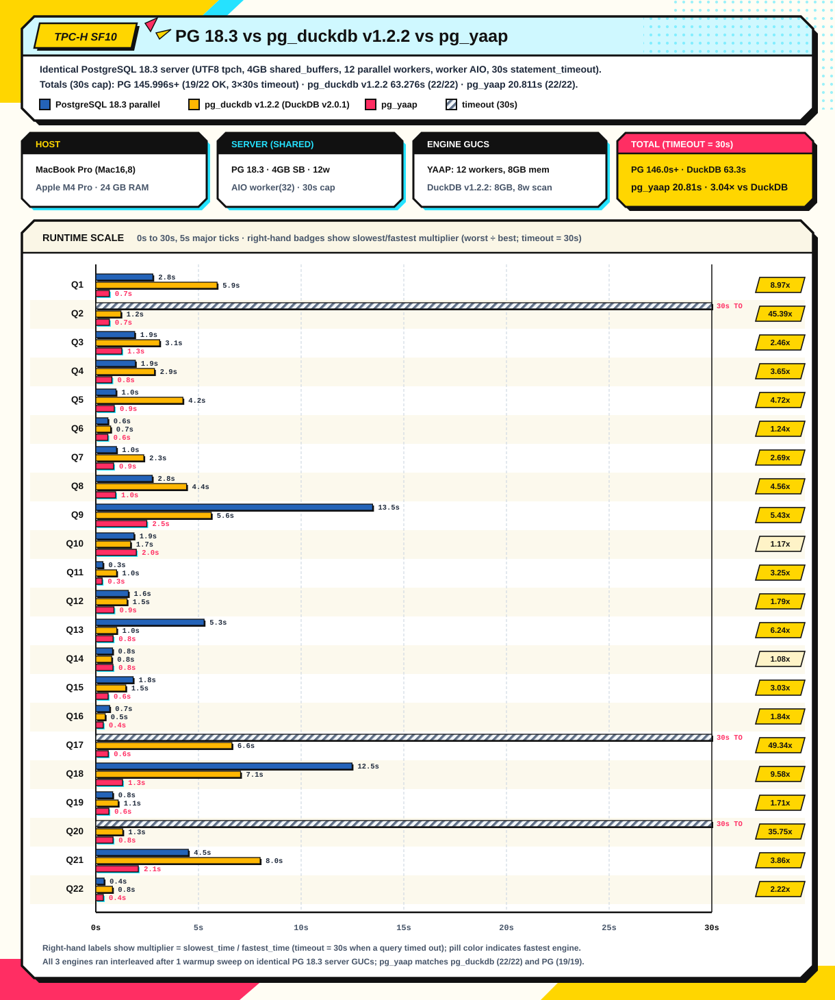
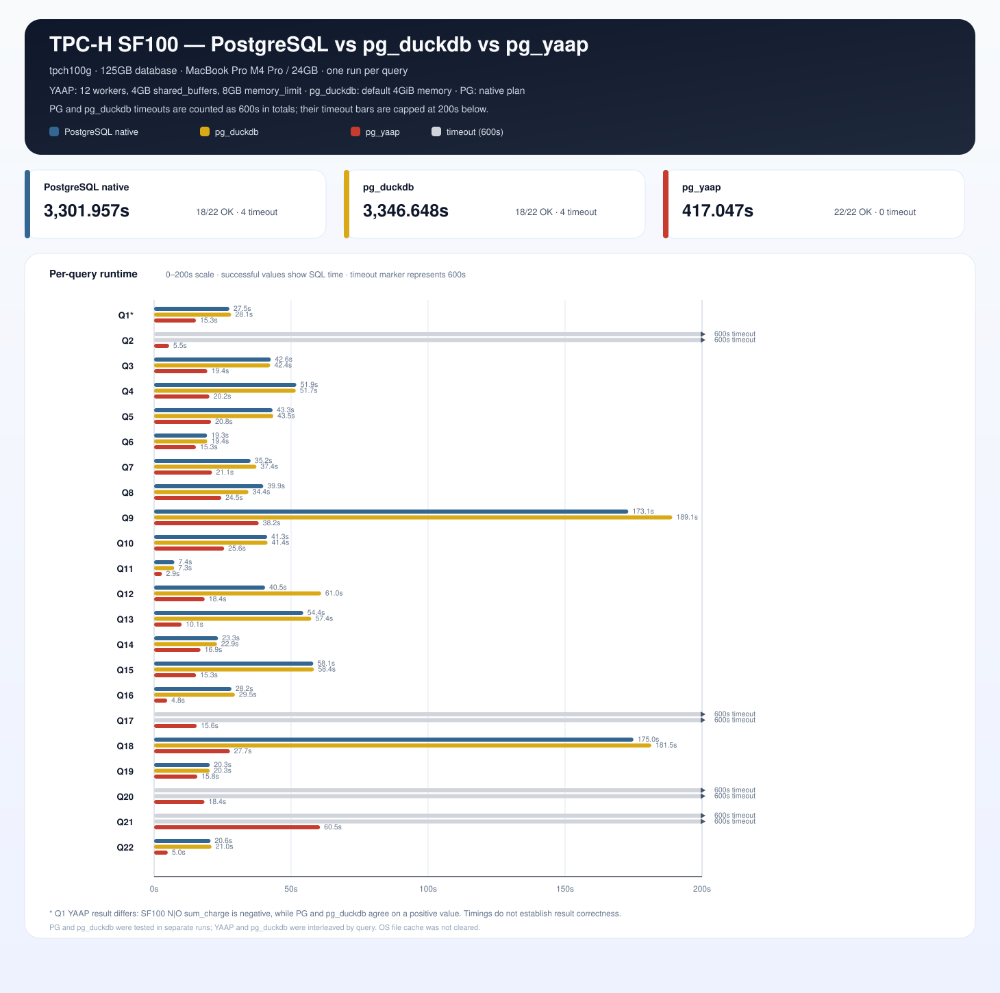

# TPC-H benchmark snapshots

These historical runs were collected on a MacBook Pro (Mac16,8) with an Apple M4 Pro (10 performance cores, 4 efficiency cores) and 24 GB RAM. The SF100 PostgreSQL database (`tpch100g`) occupied about 125 GB on disk.

## Timings and completion

| Scale | Engine | Reported SQL total | Completed | Timeouts charged to total |
| --- | --- | ---: | ---: | ---: |
| SF10 | PostgreSQL | 447.908 s | 19/22 | 3 × 120 s |
| SF10 | pg_duckdb | 95.754 s | 22/22 after retries | 0 |
| SF10 | pg_yaap | 20.516 s | 22/22 | 0 |
| SF100 | PostgreSQL | 3,301.957 s | 18/22 | 4 × 600 s |
| SF100 | pg_duckdb | 3,346.648 s | 18/22 | 4 × 600 s |
| SF100 | pg_yaap | 414.523 s | 22/22 | 0 |

YAAP's recorded wall times were 21.434 s at SF10 and 425.260 s at SF100. The SF10 PostgreSQL timeouts were Q2, Q17, and Q20. The SF10 pg_duckdb total uses successful attempts after restart and retry.

**Correctness.** At SF100, YAAP's Q1 returned a negative `sum_charge` for the `N` / `O` group, while PostgreSQL and pg_duckdb returned a positive value. Completion counts measure query execution. The published artifacts do not establish a full result-match count at either scale.

## Test conditions

| Condition | SF10 | SF100 |
| --- | --- | --- |
| `shared_buffers` | YAAP 4 GB. Baseline values unrecorded in the published artifacts. | YAAP 4 GB. Both baselines 2 GB. |
| Engine memory settings | YAAP `pg_yaap.memory_limit=8GB`. Baseline values unrecorded. | YAAP `pg_yaap.memory_limit=8GB`. pg_duckdb default 4 GiB. Native PostgreSQL settings unrecorded. |
| Parallelism | YAAP configured for 12 workers. pg_duckdb used default parallelism. | YAAP configured for 12 workers. pg_duckdb used default scan parallelism. |
| Cache policy | Unrecorded. | OS cache was left in place. Native PostgreSQL ran separately. Some of the pg_duckdb and YAAP baseline runs were interleaved. |
| Runs and timeouts | PostgreSQL and YAAP used one pass with a 120 s timeout. pg_duckdb used a 30 s timeout per attempt and retried until success. | One run per query. Each baseline timeout was charged as 600 s. |
| PostgreSQL version | Unconfirmed. | Available server logs report PostgreSQL 18.3. Exact build commits are unconfirmed. |
| pg_duckdb version | Unconfirmed. | Exact version and build commit for the measured runs are unconfirmed. |

Actual worker counts per query were not recorded in the published artifacts. The timings reflect the settings and retry policies above.

## Per-query charts

TPC-H SF10

TPC-H SF100

## Rerun and collect results

Load the TPC-H scale you want to test into PostgreSQL and supply the query files as `q1.sql` through `q22.sql`. Set `QUERY_DIR`, `PSQL`, `YAAP_LIBRARY`, and the PostgreSQL connection parameters before running the [YAAP 22-query runner](../tests/tpch22_worker12.py). The runner writes SQL, stdout, stderr, and a JSON summary to `YAAP_TPCH_OUTPUT`. Its `PASS` status means the client exited successfully. Use the [single-query runner](../src/executor/bench_tpch.sh) for targeted runs.

The per-query SVGs are the timing records published in this repository. Full raw outputs, exact engine builds, and a shared three-engine harness for these historical runs are unavailable here. For a fresh comparison, use the same timeout and cache policy across engines, record build commits and effective settings, and compare each completed result against native PostgreSQL.
