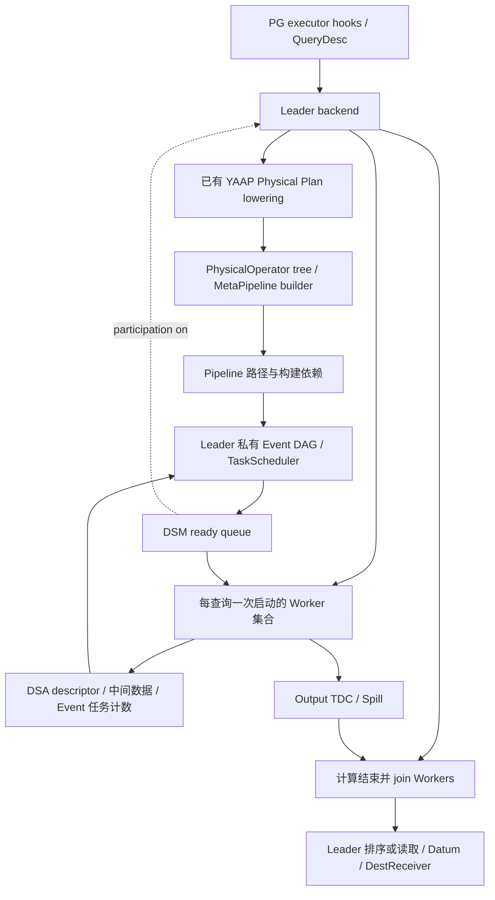

# pg_yaap 执行器架构差距分析

## 1. 评审基准与结论

本报告完整对照 v0.1 目标设计的 §0–21。检出树中设计稿实际位于[仓库根目录](../pg_yaap_executor_design.md)，共 868 行，SHA-256 为 `8a49810c864811eb0c03c813d3890a47d780c4dfe515d27e03a77f8da0e2970e`。基准 HEAD 为 `d5135fdeffd86647dbf34a23a947735f3a58bf6d`。分析以本地工作树为准，包含既有未提交的调度器、Worker、算子、测试及设计稿。仅靠 HEAD 无法还原本文行号及行为。范围为 PG 接入边界、已有 Physical Plan 的 lowering 入口、Pipeline 与进程运行时、算子和内存系统的使用协议。Planner、优化器策略和共享内存底层布局不在评审改造范围。结论来自静态走读，测试条目是验收方案，未运行数据库回归或性能基准。

- **最小改造中心在 Event 完成与任务发布交界。** 当前已有 Event DAG、全局 ready queue、查询内固定进程集合、任务级 partial ownership。Leader 持有 Event 图和未投递任务，Worker 执行并更新共享计数。修改完成协议和激活入口即可复用现有计算及调度骨架。证据见 `TaskScheduler::BuildEvents`（P/task_scheduler.cpp:92–151）、`DispatchPendingTasks`（同文件:437–462）、`pg_yaap_pipeline_worker_main`（P/pipeline_worker_main.cpp:246–257）。
- **关闭 Leader participation 只能消除常规抢任务。** Leader 仍运行初始化、默认单任务 Finalize、输出 Finalize 和最终排序。完全剔除计算可行，需同时移交算子阶段与最终有序结果的生产。证据见 `PgYaapPipelineRun`（P/pipeline_leader.cpp:812–893）、`TaskScheduler::EnqueueTasks`（P/task_scheduler.cpp:340–359）、`OutputSink::EmitGlobalTdcToDest`（P/output_sink.cpp:985–1049、1064–1109）。
- **静态 Event 图足以迁移现有算法，前提是保留算子内部的轮转和准入约束。** Hash Join hybrid RUN 的整组进度、共享预算及输出物化策略必须随协议一起保留。初版并发程度可保守，性能收益需单独测量。证据见 `TaskScheduler::EnqueueTasks`（P/task_scheduler.cpp:300–325）、`PgYaapPipelineRun`（P/pipeline_leader.cpp:869–889）、`PipelineRunTask::Execute`（P/task.cpp:273–304）。

下文源码定位使用 `P/` = `src/executor/engine/parallel/pipeline/`，`B/` = `src/bridge/`，`M/` = `src/executor/buffer_manager/`。行号对应上述工作树。

## 2. 当前执行链路和模块职责

| 阶段 | 当前链路及源码证据 |
|---|---|
| PG 接入 | `pg_yaap_ExecutorStart` 有两条 PG 初始化分支。普通计划先走上一层或标准 Hook，optimizer-only 调用 `pg_yaap_start_optimizer_executor` 创建 EState、注册 snapshots、检查权限并构建输出 TupleDesc，planstate 为空。之后 Worker bypass，申请并登记 QueryDesc 对应状态。B/pg_yaap.c:722–815，`pg_yaap_try_build_query_state` B/state.c:102–132。 |
| Runtime lowering | `pg_yaap_initialize_plan` 检查 bundle support、建立 DSM/DSA，再从 bundle 调 `BuildPipelineFromOptimizerPlan`。`TranslateOptimizerNode` 生成运行时 PhysicalOperator 树，`BuildOutputContract` 套上 OutputSink。query state 中 `parallel_scheduler` 是 sentinel，实际 scheduler 在 Run 中建立。B/execute.cpp:60–150，P/yaap_pipeline_init.cpp:99–125、139–205，P/yaap_opt_translator_exprs.cpp:1337–1407。 |
| Pipeline 构建 | `PgYaapPipelineRun` 取走根节点，`MetaPipeline::Build` 保有树并创建 top pipeline。`PhysicalOperator::BuildPipelines` 让终端 Sink 留在当前路径，breaker 拆成生产者 Sink 和消费者 Source，普通算子在子节点之后依序追加。B/pg_yaap.c:820–845、B/execute.cpp:183–213，P/pipeline_leader.cpp:479–521，P/meta_pipeline.cpp:9–50，P/physical_operator.cpp:10–52。 |
| 计划和快照发布 | Leader 将 QueryDesc snapshot 序列化进 DSA，`LeaderSerializePipelines` 按 id 保存 Source/Ops/Sink 描述、schema/layout 等引用并挂接 payload 描述符。建立私有 Event 与 DSA 任务计数，注册一次动态 bgworker 群组，等待启动/ready，最后登记唤醒 PID 并投递根 Event。P/pipeline_leader.cpp:563–591、613–745、773–782，P/pipeline_descriptor.cpp:637–690。 |
| Worker attach 与执行 | `pg_yaap_pipeline_worker_main` attach DSM/DSA，连接数据库，启动本地事务并 `RestoreTransactionSnapshot`/`PushActiveSnapshot`，attach SharedFileSet。ready bit 先于本地 Pipeline 重建，因此它表示 PG/DSM 准备就绪，重建失败仍走整查询错误。任一 Worker 反复从共享队列领取任意 Pipeline 的任务，同一 Worker 可跨阶段。P/pipeline_worker_main.cpp:80–175、207–257，`WorkerReconstructPipelines` P/pipeline_descriptor.cpp:796–821。 |
| Batch 协议 | `PipelineRunTask::Execute` 建立每 RUN 私有状态与 chunk，循环 `GetData → DrainOperatorSuffix → SinkChunk`。后者在同一输入上重入 `HAVE_MORE_OUTPUT`；EOF 之后按算子顺序调用 hybrid probe 的 `FinalExecute`；正常退出先 `FinishLocalSink`，再释放本地 source、probe、scratch。COMBINE/FINALIZE 独立领取，仅解析共享 Sink 状态。`BLOCKED` 明确报错。P/task.cpp:25–62、148–205、226–330、341–404。 |
| 输出与清理 | Leader acquire 观察计数归零，执行消费后清理，再推进事件。全部 Event 终态后停止并等待 Worker，保持 DSA 映射，之后通过 `OutputSink::EmitGlobalTdcToDest` 物化 PG slot 与调用 DestReceiver，最后销毁 DSM/DSA。异常由 Run 的 PG_CATCH 停 worker、释放 JIT 注册及 runtime；ExecutorEnd 删除 query state、注销 bundle。P/pipeline_leader.cpp:847–867、898–1000、1001–1025，P/output_sink.cpp:940–980、1045–1061、1115–1155，B/pg_yaap.c:873–900，`pg_yaap_close_query_state` B/state.c:93–98。 |

## 3. Pipeline 依赖与 Event DAG

| 维度 | 现有协议及目标差异 |
|---|---|
| Pipeline 与 MetaPipeline | `Pipeline` 保存 id/source/ops/sink/depends_on。边方向是消费者记录生产者 id。`MetaPipeline::CreateChildPipeline` 填边，Builder 返回 bundle 后 MetaPipeline 对象退出；其构建能力应保留。HashJoin/CrossProduct 覆盖 BuildPipelines 增加 build 侧；Materialize 可让多个消费者指向同一个生产 Pipeline。P/pipeline.hpp:24–34，P/meta_pipeline.cpp:9–50，P/physical_hash_join.cpp:2253–2279，P/physical_cross_product.cpp:317–326，P/physical_delim_scan.cpp:322–332。 |
| Event 结构 | `BuildEvents` 每 Pipeline 固定 `RUN → COMBINE → FINALIZE`，EventId 为 `pid×3+kind_offset`；跨 Pipeline 边 `producer.FINALIZE → consumer.RUN`。Event `AddDependency` 计入度，用前驱的 weak dependent 列表释放后继；`CompleteDependency` 等最后一条边；`TrySchedule` CAS 从 PENDING 转 SCHEDULED 后同步执行 Schedule。P/task_scheduler.cpp:92–151、283–289，P/event.cpp:17–55。 |
| 调度权威 | 现有**常规后继**已由 Event 边释放，Worker 没有第二套 Pipeline 调度器。Pipeline 依赖仍被 Leader 用于首批 RUN 选择并随 descriptor 重建，依赖掩码仅 64 位（限制的是被引用 id，见断言与移位）。目标可让 Event 入度选择根，并去掉 worker descriptor 的依赖副本；构建期保留 `depends_on` 即可。P/pipeline_leader.cpp:769–782，P/pipeline_descriptor.cpp:55–63、646–655、796–820，P/event.cpp:70–90。 |
| 阶段完成 | Source EOF 是单个 RUN 开始 drain 的条件；RUN 完成要求该任务 sink 局部发布；全 RUN 完成后 Leader 先清理 consumer 和 hybrid 准入再释放 COMBINE；后者消费 partial；FINALIZE 完成才允许消费者读。零任务能同步完成；当前 `FinalizeIsTrivial` 分支仍调用 Finalize。P/task.cpp:248–330，P/pipeline_leader.cpp:847–865，P/task_scheduler.cpp:327–385。 |
| 共享 Sink 与终点 | 已有多任务生产者汇入同一 RUN，以及单物化生产者扇出给多个消费 Pipeline；`BuildEvents` 为每个 Pipeline 创建自己的 COMBINE/FINALIZE，没有跨多生产 Pipeline 的 Sink-group 单一 Finalize 合同。若多个生产 Pipeline 真共用可变 Sink，要为该组统一收集生产者与退出清理。当前通过扫描所有 Event 的 FINISHED/ABORTED 判断终态，未见独立 EOS 与 QueryComputeComplete 节点，以及重复边、环、终点覆盖验证。P/physical_delim_scan.cpp:322–332，P/task_scheduler.cpp:115–151，`AllEventsFinished` P/pipeline_leader.cpp:279–290、895–899。 |
| 跨进程推进 | `Event` 的 C++ 实例、依赖、阶段 backlog、hybrid 准入都在 Leader；DSA `EventShmState` 只含 remaining/in-flight/concurrency。Worker 减计数后唤醒 Leader，Leader 执行 `FinishEvent` 与后继激活。现有 Event 的 Abort/Finish 都直接 exchange 终态，现有主路径由 Leader 串行推进，移交时必须改为有前态校验的单调状态转换，以免先写后判断覆盖终态。P/task_scheduler.cpp:65–88、190–210、411–462，P/pipeline_worker_main.cpp:246–257，P/pipeline_leader.cpp:787–867，P/event.cpp:58–90。 |

目前跨 Pipeline 数据就绪边已经具备 AND 语义。最小目标图以 `RUN → COMBINE → FINALIZE` 为默认模板，加入必要的 INIT/Publish/清理事件及唯一成功终点。允许零工作阶段，阶段完成与已发布数据之间需有明确可见性，清理位置按最后消费者和 pin 生命周期决定。Event 拓扑需要可由 Worker 读取，具体 DSM/DSA 表示放在后续详细设计。

## 4. 剔除 Leader 计算的可行性

| 当前工作 | participation=off 的效果 | 目标中的归属 |
|---|---|---|
| 普通 RUN/COMBINE/分区 FINALIZE | 关闭 Leader 的队列消费。Root RUN 同样通过队列执行，Worker 可以执行。默认开关为 on。P/pipeline_leader.cpp:400–431、869–893，B/pg_yaap.c:50、373–379。 | Worker，复用任务执行器和 taskIndex。 |
| 单任务 FINALIZE | Leader 循环直接执行 leader-only FINALIZE，与开关无关。默认 `PhysicalOperator::GetFinalizeTaskPlan` 返回一个 leader-only task，常规 HashAgg、Order 等走此默认；HashJoin flat、单分区或 paired 显式选择此路径。Worker 当前拒收不含 partition_id 的 FINALIZE。P/physical_operator.hpp:113–123，P/physical_hash_join.cpp:2175–2183，P/pipeline_leader.cpp:812–844，P/pipeline_worker_main.cpp:233–243。 | 改由任一 Worker 领取唯一 unpartitioned task，逐项验证状态 attach；保留分区计划。允许单独的发布回调由 Worker 完成。 |
| Trivial Finalize 与 Init | 仍在 Leader；`PipelineRunEvent::Schedule` 调用 source/sink global getter，`EnqueueTasks` 初始化 hybrid，`OutputSink::Finalize` 被 inline 调用并可能 seal/spill。P/pipeline_run_event.cpp:18–54，P/task_scheduler.cpp:319–359，P/output_sink.hpp:139，P/output_sink.cpp:880–936。 | 将依赖上游结果的初始化及计算性发布放在 Worker 激活阶段；将必须在 Leader 执行的 PG 上下文准备留在启动时。对当前按 `worker_index == LEADER_WORKER_INDEX` 分配的 payload 引入唯一初始化所有者，由 Event 选择而非伪造 worker index。 |
| 最终有序输出 | 仍在 Leader。当前 lowering 的普通 ORDER BY 填 `final_sort_keys`。segment-backed 输出通过 `TdcExternalSorter`，flat 输出使用索引 `std::sort`；小 Top-N 的候选筛选与最后排序分属 Sink 与 Leader。P/yaap_pipeline_init.cpp:194–205、218–253，P/yaap_opt_translator_exprs.cpp:1352–1405，P/output_sink.cpp:780–866、985–1049、1064–1118。 | 同一比较及物化算法迁到 Worker 的有序输出阶段，Leader 保留 spill 结果读取、PG 编码与 DestReceiver。先保持单输出生产者及 LIMIT 在全序上的现有语义。 |
| Worker 管理、错误及资源回收 | Leader 仍注册、监控、唤醒并 join；通常完成后才向客户端发送。P/pipeline_leader.cpp:144–216、613–745、943–989。 | 保留 PG 生命周期管理和输出适配。RUN 完成时当前用于允许下一阶段运行的算子释放、准入归还转交 Event 完成协议；全局销毁仍由 Leader 在访问结束后做。 |

当前 Worker 数按请求值及可选 Leader 定尺寸。注册、启动或等待 ready 的任一步失败，就走 `FailEarly`，包括已经有部分 Worker 的情况；配置为 0 在启动前直接拒绝。目标允许部分启动成功继续，要求在首任务发布前冻结实际 ready 计算者、建立密集索引或显式映射、按实际数量计算 RUN cohort 和预算。既有槽位可按请求数量预留。N=0 报明确错误，N=1 保证可独立完成，运行中掉 Worker 则整查询失败。HashJoin 目前可在 BuildPipelines 中按请求数选择 hybrid，部分启动时须验证 hybrid 在实际单 Worker 下的行为，或推迟执行路径选择（P/physical_hash_join.cpp:2253–2278）。证据为 `PgYaapPipelineRun`（P/pipeline_leader.cpp:527–538、563–591、613–744）与 `ExecutionWorkerCount / ExecutionTaskSlot`（P/execution_slots.hpp:13–27）。

现有结果是共享物化数据，不存在 Worker→Leader 增量结果队列、消费水位或 EOS。Leader 等所有 Event、关闭并 join Worker 后才 drain，因当前物化没有等待 Leader 腾出队列空间，所以不产生该类背压死锁。低风险第一步沿用可落盘物化，由 Worker 生成并发布最终顺序单一的结果，Leader 按序读、编码和退役；明确保留数据预算、磁盘占用与首行等待。若后续引入有界流式通道，必须在计算期间持续 drain，区分 EOS、compute_done、result_drained，并使空间等待可被取消。证据见 `PgYaapPipelineRun`（P/pipeline_leader.cpp:895–899、943–989）与 `OutputSink::Finalize / EmitGlobalTdcToDest`（P/output_sink.cpp:880–936、981–1061）。

**当前 PG 生命周期缺口。** `pg_yaap_execute_query` 忽略 `direction/count`，状态在首个 Run 被消耗，成功后清除 scheduler sentinel。现行接管检查也忽略 eflags，因此分次 FETCH、反向及 Portal suspension 不能视为已有保证，初版需明确允许的完整前向调用，或者单独补等价续读。segment-backed 分支记录 `receiveSlot=false` 后不再发结果，flat 分支忽略返回值。Worker 用动态 bgworker 的独立事务恢复 Leader snapshot；该代码证实了快照接力，仍需验证并行安全、当前事务未提交写入、临时表、角色/RLS/GUC、锁和 SSI 的等价性。证据见 B/state.c:102–125 的 `pg_yaap_try_build_query_state`，B/execute.cpp:183–208 的 `pg_yaap_execute_query`，P/pipeline_leader.cpp:479–480、988–989 的 `PgYaapPipelineRun`，P/output_sink.cpp:993–1023、1115–1146 的 `EmitGlobalTdcToDest`，P/pipeline_worker_main.cpp:106–120 的 Worker 入口。

## 5. 共享状态、同步与生命周期

`Global*State` 多为进程私有访问对象，真正共享的是可由 DSA handle 找到的 payload。每个 Worker 通过 descriptor 重建私有算子对象。同一 Leader 算子可在不同 Pipeline 拥有不同描述槽；现有 Store 会将 payload 写到已 attach 的相关槽，Worker 的私有缓存不能充当发布机制。RUN 局部状态每个 task 新建，COMBINE/FINALIZE 的 process-local wrapper 可以缓存；保留进程和逻辑任务的两个身份。证据见 `WorkerReconstructPipelines / StoreSharedPayloadOnDescriptor / LoadSharedPayloadFromDescriptor`（P/pipeline_descriptor.cpp:796–869、968–1024）、`PipelineRunTask::Execute / PipelineCombineTask::Execute / PipelineFinalizeTask::Execute`（P/task.cpp:226–259、341–402）、P/execution_slots.hpp:13–27。

| 状态/数据 | 归属与发布 | 同步、等待及回收证据 |
|---|---|---|
| DSM / DSA 根 | DSM TOC 中包含 `PipelineSharedControl`、DSA base、队列、ready 原子数组；控制块保存 snapshot、descriptors、Event 计数、profile、arena roots、SharedFileSet、关闭和错误。Leader 建立，Worker attach 后以本地 DSA wrapper 解析地址。 | `CreateRuntimeDsm` P/runtime_dsm.cpp:97–175，`PipelineSharedControl` P/dsm_control.hpp:60–167，Worker 入口 P/pipeline_worker_main.cpp:82–123；`DestroyRuntimeDsm` 在 join 后销毁 arenas、删共享 spill 文件、detach DSA/DSM，P/runtime_dsm.cpp:179–228。 |
| 任务队列、通知 | 当前单个 Leader 生产，Worker 和可选 Leader 竞争消费。固定环容量，槽含 descriptor 和 64 位 sequence。完整 descriptor 写完才发布 sequence；消费者读后再释放槽。 | `TryPush / TryPop` CAS 领取 cursor，配合带 barrier 的 sequence；push 唤醒登记的进程，pop 唤醒固定 producer PID。队列满保留 Leader backlog。Worker/Leader 闲置用 Latch 与 1 秒重检；Latch 是通知，队列和终止原子才是谓词。P/dsm_task_queue.cpp:40–128，P/task_scheduler.cpp:437–462，P/pipeline_worker_main.cpp:169–205，P/pipeline_leader.cpp:895–921。 |
| Event 任务计数 | Leader 以共享数组写 `tasks_remaining`，整批先记数，随后给可投递任务加 `tasks_in_flight`；该值包括排队、已领、运行任务。Worker 正常完成减计数，Leader acquire 读零再清理和放行。 | `AllocateEventShmStates / EnqueueTasks / DispatchPendingTasks` P/task_scheduler.cpp:190–210、373–407、437–462，P/pipeline_worker_main.cpp:246–257，P/pipeline_leader.cpp:847–865。迁移需保证任务结果发布→最后完成者→后继可见的有序链，终止时禁止正常 release。 |
| 共享 SeqScan 范围 / 私有扫描 | Leader 读取真实关系块数并初始化 PG ParallelBlockTableScanDesc；每个 RUN 打开 Relation、以 active snapshot 建 heap scan，自有 read stream 和 chunk。PG 动态分配范围；同一 task 循环处理多个范围。 | `GetGlobalSourceState / GetLocalSourceState` P/physical_seq_scan.cpp:1052–1125，`SeqScanReadNextParallel / InstallParallelSeqScanReadStream` P/physical_seq_scan_read_stream.cpp:82–165。`table_block_parallelscan_startblock_init / nextpage` 保护共享起点及原子领取量，PostgreSQL 源码 `src/backend/access/table/tableam.c:422–520`（扩展外层仓库路径）。本地 Source 先在 RUN 尾销毁，DSA payload 随 Query。 |
| TDC、变长数据 | 私有 DataChunk 的字符串在 scatter 时复制到 TDC heap 或 inline，跨进程描述符只保留相对位置/handle；消费时在 lease 有效期内读取并复制到下一个容器。 | `TupleDataCollectionStoreStringBytes` 的 heap 游标和 `TupleDataCollectionAppendRow` 的 row_count 各受 TDC spinlock 保护；scan cursor 原子领取。P/tuple_data_collection.cpp:209–249、322–385，`Scatter / ScatterGroupColumns` P/tuple_data_ops.cpp:435–444、378–391。读到 row_count 与数据整体 ready 是不同的保证，TDC 仍依赖阶段或独占 segment 发布。 |
| Segment 与 Spill | 生产者独占 writable segment，seal/publish 后消费者通过 arena/id/generation 获取 lease；spill 使 resident 数据释放而保留文件 extent 与逻辑 handle；reload 后继续读。 | arena spinlock 保护目录、ID/退休；状态转换、读 lease/pin 通过原子，spill/reload 竞争者观察状态。M/yaap_shared_segment_arena.cpp:180–254（`YaapSharedSegmentSpill`）、259–337（`YaapSharedSegmentReload`）、733–794（`YaapSharedSegmentArenaAllocate`）、819–945（Seal、Publish、AcquireRead、ReleaseRead、Retire）。`YaapSpillStore::WriteBlock / ReadBlock` 保存并重开 extent，M/yaap_spill_store.cpp:200–239、254–285。 |
| 预算与进度 | DSA 段容量上限，与 buffer payload hard/soft budget 分开；buffer 外部分配按进程共享的 CAS 记账，退役/落盘返还。SQL tuplesort、进程私有 scratch 等另有开销。 | `CreateRuntimeDsm` P/runtime_dsm.cpp:47–95、144–166，`YaapBufferTryChargeExternalBytes / YaapBufferReleaseExternalBytes` M/yaap_buffer_shared.cpp:42–105，`TrimLocalScratchIfUnderPressure` P/task.cpp:107–131，`TdcExternalSorter` P/physical_order.cpp:240–279。 |
| HashJoin / HashAgg shared | Join 按 RUN slot 发布 partition chains，Finalize 或 hybrid 批次建表，Probe 使用自己游标/lease；某些 Join 的 matched bitmap 仍会共享原子更新。Agg 各 RUN 本地 partial，分区 COMBINE 扫所有发布条目。 | `FinishLocalSink / FinalizePartition` P/physical_hash_join.cpp:3183–3205，P/physical_hash_join.cpp:4712 的 matched OR；Agg `Combine` P/physical_hash_aggregate.cpp:1864–1941 的 partition LWLock、输入 retire，`GetData` 同文件:2072–2144 的原子分区领取及 lease。Join 底层资源由消费 RUN 或 Query 尾清理，P/pipeline_leader.cpp:299–358、847–862。 |
| Materialize / Output | Materialize 每任务 seal 后 CAS 挂链，消费者共享 backing data，但每一引用各自维护分工游标。Output TDC 为单最终消费者持有，直到 Leader drain 才退役。OutputSink 限制一个 RUN 写者（`MaxThreads`，P/output_sink.hpp:120）；输出行上下文在 receiveSlot 返回后重置。 | `PhysicalMaterialize::FinishLocalSink / GetData` P/physical_delim_scan.cpp:359–402；`OutputSink::Finalize / EmitGlobalTdcToDest` P/output_sink.cpp:880–936、993–1061、1152–1169。一般扇出不能沿用单消费者的 retire 时机。 |
| Abort、错误和进程退出 | 首个错误用 CAS `NONE→WRITING` 占有诊断，文本写完 barrier 发布 READY。Leader 检查 Worker handle 与共享错误；错误分支停、唤醒并等进程，随后删文件/DSA 并重抛。 | `WorkerErrorPending / WorkerErrorMessage / ReportWorkerError` P/worker_error.hpp:21–68，`DetectUnexpectedWorkerExit / SignalShutdownAndWait / RaiseWorkerFailure` P/pipeline_leader.cpp:144–216、364–396，Worker 入口 P/pipeline_worker_main.cpp:259–297。WRITING 期间 reporter 退出能回传通用诊断。启动错误与运行错误应分别验证。 |

队列和阶段计数已有发布顺序。普通 Pipeline 依赖无需全体 Barrier；hybrid 的 cohort Barrier 是算子资源协议，不能由 Event 边直接替代。新调度器若允许多个阻塞 cohort 同时只派出一部分任务，可能让所有 Worker 等待尚在队列中的成员，即使 DAG 无环。取消测试还需覆盖队列满、等待工作、等待 hybrid 批次、读写 spill 和慢客户端。当前等待有超时检查，但本文未证明所有阶段的无丢唤醒、锁顺序及中断延迟。证据见 `InitializeHybrid` 及 probe barrier 调用（P/physical_hash_join_probe.cpp:1072–1132、1215–1277），`WorkerShutdownRequested`（P/pipeline_worker_main.cpp:53–60）与 `SignalShutdownAndWait`（P/pipeline_leader.cpp:167–199）。

## 6. 算子、Spill 与兼容边界

| 模块 | 已有计算与阶段合同 | 迁移判断 |
|---|---|---|
| HashJoin Build | `BuildPipelines` 构造 build 生产者，支持普通 probe 与符合条件的 hybrid 路径。segmented build 的 `FinishLocalSink` 在 RUN 尾封存并发布，COMBINE 可为零；flat 路径仍需 RUN 后合并。非 paired 的多分区 segmented build 可用 `FinalizePartition`，并行度按最大分区及工作集估算；flat、单分区和 paired 当前用 Leader 单任务。P/physical_hash_join.cpp:2159–2225、2253–2279、3183–3205、3408–3467。 | **可复用**。保留 RUN 与 COMBINE/FINALIZE 边及按分区独占。单任务迁给 Worker 后仍须根据 shared payload 判断 ready；paired 的 Init/Finalize 发布目录和计数，后续按需装入批次，不能假设已构建全体驻留哈希表。 |
| HashJoin Probe / 外部轮转 | `InitializeHybrid` 固定合作者，做驻留批次、预算及 Barrier 初始化。`FinalExecute` 处理 deferred probe、未匹配或匹配 build 输出和批次切换；批次通过成组 pin/build/probe/release 协议轮转。Probe 类型和 join mode 影响是否需要尾部 build scan。共享匹配位允许原子 OR。P/physical_hash_join_probe.cpp:705–768、1072–1132、1215–1302，P/physical_hash_join.cpp:4712，P/task.cpp:273–304。 | **静态图兼容**。先把有限轮转留在一个 RUN 内，保留准入和整组可调度性，并将资源释放绑定到所有必要消费者完成。首版无需动态子图。如果后续拆散 gang，需要把批次的 pin/build、probe、unmatched 与 release 依赖显式化，轮数未知时才考虑受控子事件。 |
| HashAggregate / PerfectHash | 普通 HashAgg 的本地 partition partial 用 RUN slot 注册，`GetCombineTaskPlan` 以分区为工作单位；`Combine` 汇入所有有效局部状态并释放输入。Finalize seal/spill、标记共享 payload finalized，Source 领取可读分区。单 COUNT(DISTINCT) 有共享 set 特例。PerfectHash 的 `GetCombineTaskPlan` 要求一个 COMBINE，遍历所有 task slot 后释放，Finalize 发布来源。P/physical_hash_aggregate.cpp:1319–1377、1498–1598、1604 起、1864–1941、1945–2040、2072–2144，P/physical_perfect_hash_aggregate.cpp:304–310、458–525。 | **可复用**。保留分区/单任务 cap 和状态数据类型；迁当前单任务 Finalize。若将来多个 Pipeline 写一组 Sink，先定义跨 Pipeline slot 命名及一次 Finalize。COUNT(DISTINCT) 保留现有分区锁，不纳入普通 task-local partial 改造。 |
| Sort | 类 `PhysicalOrder` 的 `MaxThreads=1`，Sink 物化，Finalize seal/spill，`GetData` 通过私有 `TdcExternalSorter` 调 PG tuplesort 做 run/merge，读完退役输入。当前活跃普通 ORDER BY lowering 走 OutputSink 排序元数据。P/physical_order.hpp:124，P/physical_order.cpp:238–275、502–599、651–697，P/yaap_pipeline_init.cpp:194–205，P/yaap_opt_translator_exprs.cpp:1375–1405。 | **可复用现有串行外排**。把实际结果路径的 Sort 放到 Worker，复用既有比较和 tuplesort。多轮 merge 留在 PG 内部；无需共享私有 tuplesort 指针，也无需新建并行 sorter。单个有序输出者可用受预算的 spill 结果将全序交给 Leader。 |
| TopN / Limit | 常规 ORDER BY + LIMIT 生成 `PhysicalTopN`，清除末端 sort keys；它在共享 TDC 上筛选候选，Finalize 对索引排序，Source 按索引消费。另有终端 OutputSink 的 bounded replacement/emit cap 分支；无序 LIMIT 当前也由输出合同封顶。OFFSET 在支持检查中被拒绝。P/yaap_pipeline_init.cpp:208–291，P/physical_top_n.cpp:416–483、498–533、553 起，P/output_sink.cpp:780–866、1111–1114，`AnalyzeLimitNode` P/yaap_opt_translator_support.cpp:133–153。 | **保守兼容**。移交排序 Finalize，保持排序后 LIMIT、NULLs、ties 及比较语义；全局并发早停可单独评估。TopN 现有每行锁内有 rebuild/free 路径，优先把锁内分配和报错审计列为上线门槛，局部候选算法可后置。 |
| Spill | segment arena 和 named SharedFileSet 跨进程复用，Join 支持 build/probe 批次 spill，HashAgg 局部和全局分区按压力处理，Sort 有 PG 外排，现有 output 也有可落盘 segment。M/yaap_shared_segment_arena.cpp:180–337、887–945，P/physical_hash_join_probe.cpp:575–585、705–768，P/physical_hash_aggregate.cpp:1864–1941、2004–2037，P/physical_order.cpp:238–275、335–340，P/output_sink.cpp:904–930。 | **兼容但受进度约束**。复用现有预算与 extent，Event 只管理是否准入、工作集额度、消费完成。先限制并发高峰，给 spill/reload 和有序输出留空间；Materialize 现有容量不足会报错，不能由其他算子的 spill 推导出通用 spill 保证（P/physical_delim_scan.cpp:350–354）。 |
| 跨 Pipeline 重用和特殊语义 | Delim materialize 有一份生产、多份 replay 的特例。HashJoin lowering 按 mode 处理已接管的 LEFT/RIGHT、SEMI/ANTI、MARK、scalar delim；FULL 无法由此分支接管。当前 support switch 未接纳通用 Window、DISTINCT/SetOperation 节点；展示类名不代表可执行。P/physical_delim_scan.cpp:310–332、359–402，P/yaap_opt_translator_nodes_join.cpp:120–147，`AnalyzeOptimizerPlanNode` P/yaap_opt_translator_support.cpp:237–260。 | **保持接管覆盖**。保留现有 decorrelated/Delim epoch 与物化复用。通用参数化/Rescan、递归 CTE 与 WINDOW 不从静态 DAG 自动获得支持；加测试区分当前支持和拒绝。按已支持模式验证匹配位、NULL、重复行、SINGLE 语义和每引用完整 replay。 |

上述“兼容”意指已有算子算法可映射到阶段合同。跨进程转移的调用路径、初始化唯一性、清理所有权仍须验证。

## 7. D01–D12 决策对照

| 决策 | 判断 | 当前证据与差距 | 最小动作 / 验收 |
|---|---|---|---|
| D01 在现有 Executor 内落地 | **满足** | B/execute.cpp:101–150、183–213 的 `pg_yaap_initialize_plan / pg_yaap_execute_query` 已进入现有 pipeline runtime。 | 原路径内分阶段迁移，构建及入口回归。 |
| D02 既有 YAAP Physical Plan | **满足** | `BuildPipelineFromOptimizerPlan` 从 bundle 读取 Physical Plan 并 lowering 到 runtime，P/yaap_pipeline_init.cpp:99–125。 | 冻结输入合同，按同一计划比较。 |
| D03 Pipeline 只描述计算路径 | **部分满足** | `MetaPipeline::CreateChildPipeline` 写构建依赖，Leader 仍从 Pipeline 选根且 serialize/reconstruct 依赖。P/meta_pipeline.cpp:38–50，P/pipeline_leader.cpp:773–782，P/pipeline_descriptor.cpp:55–63、816–818。 | 由 Event indegree 派生根，移除运行时依赖副本；测试长链和高 id 依赖。 |
| D04 Event 是唯一依赖权威 | **部分满足** | `BuildEvents` 与 `CompleteDependency` 已表达阶段和后继；缺 Worker 可访问的图、统一终点与显式 Sink group 验证，根选择仍用 Pipeline。P/task_scheduler.cpp:92–151、190–210，P/event.cpp:17–55，P/pipeline_leader.cpp:773–782、898–899。 | 复用编图、添加验证和共享推进；diamond、共享 Sink、零任务、重复边/环、完成竞态。 |
| D05 Query 固定 Worker 池 | **部分满足** | `PgYaapPipelineRun` 注册一次并等全员 ready，以请求数定 sizing；部分失败整体失败。P/pipeline_leader.cpp:563–591、613–744，Worker loop P/pipeline_worker_main.cpp:169–257。 | 冻结实际 ready 群组；0、1、部分、N 启动及运行中失联。 |
| D06 Leader 仅协调与消费 | **存在差距** | `PgYaapPipelineRun` 可抢任务且执行默认 Finalize；`EnqueueTasks` inline output Finalize；`EmitGlobalTdcToDest` 排序。P/pipeline_leader.cpp:812–893，P/task_scheduler.cpp:340–359，P/output_sink.cpp:985–1049、1085–1109。 | Worker 执行全部计算阶段，端到端 trace：Leader 算子任务、比较和归并均为 0。 |
| D07 Worker 自主推进 | **存在差距** | Worker 仅减计数、唤醒；Leader 私有 DispatchPendingTasks、清理和 FinishEvent，队列 pop 通知固定 producer。P/pipeline_worker_main.cpp:246–257，P/pipeline_leader.cpp:787–865，P/dsm_task_queue.cpp:66–73、106–121。 | Worker 操作共享激活/完成；模拟 Leader 只 drain/监管，验证独立分支仍推进及满队列可恢复。 |
| D08 Task 与 Morsel 分离 | **满足** | `DeriveRunTaskCount` 按执行者与各算子 cap，`SeqScanReadNextParallel` 随实际块领取，RUN 循环至 Source 终止。P/task_scheduler.cpp:222–243，P/physical_seq_scan_read_stream.cpp:82–128，P/task.cpp:263–330。 | 保持 Table AM 领取，测空表、估算偏差、多块及过滤空批。 |
| D09 共享与私有分离 | **满足** | `WorkerReconstructPipelines` 重建对象，`Store/LoadSharedPayload` 分享 DSA 引用；RUN 本地状态单独创建。P/pipeline_descriptor.cpp:796–869、968–1024，P/task.cpp:226–259。 | 保持 handle、lease 和任务身份，不跨进程传 wrapper；以变长数据和不同进程接棒验收。 |
| D10 独占写入、发布后消费 | **部分满足** | Join/Agg 分区 ownership、Materialize 发布已具备。TopN `SinkChunk` 共享候选并锁内重建，DISTINCT 和 matched bits 有显式共享写。P/physical_hash_join.cpp:3183–3205、4712，P/physical_hash_aggregate.cpp:1510–1523、1864–1941，P/physical_delim_scan.cpp:359–371，P/physical_top_n.cpp:416–483。 | 维持合法共享写，审计异常路径临界区；压力、字符串、重复消费、匹配位正确性。 |
| D11 Query 统一内存预算及 Spill | **部分满足** | `CreateRuntimeDsm` 有统一共享额度和 DSA 上限，segment 与部分 sort scratch 记账；尚无通用 Event reservation/进度政策，私有 scratch 和直接 DSA 分配未统一计入 payload ledger。P/runtime_dsm.cpp:47–95、144–166，P/physical_order.cpp:238–274，P/task.cpp:107–131，P/yaap_pipeline_init.cpp:244–266。 | 先复用账本、按高峰准入，给回读/排序留保底；检查并发低预算、热点分区、明确溢出或失败。 |
| D12 失败整查询终止 | **满足核心决策** | `pg_yaap_execute_query` 对已接管失败报错，Worker `BGW_NEVER_RESTART`，共享错误触发 join/destroy，无 Task 重试。P/pipeline_leader.cpp:166–216、622、787–793、1001–1025，B/execute.cpp:183–213。 | 保留 fail-fast；强化取消不能被记成成功，测首错/取消/退出的竞态与清理。 |

## 8. 最小改造顺序与验收

所有步骤为待评审提案。当前子目录规则规定由 Leader 负责 FinishEvent，沿用 DSA 物化输出和现有算子接口，后续只在方案获确认后调整被新协议取代的约束。建议先复用可执行结构，对齐完成语义，再验证并发和性能。

| 顺序 | 涉及模块与最小变更 | 验收证据 |
|---|---|---|
| 0 建立基线 | 固定本地目标版本及工作树快照。从现有 `pg_yaap.profile` 和 timeline 记录各 Event/进程任务、分区/Spill、首行和总耗时，保留 Query 输出差分。先单测现有 Leader on/off。 | `tests/pipeline_scheduling.py:12` 的 `main` 只证明 OFF 时没有 Leader RUN，扩至全部计算阶段。`tests/pipeline_stage_plans.py:16` 的 `main` 覆盖独立 build、分区及 perfect agg。`tests/pipeline_timeline.py:56、118` 可复用 trace 校验。 |
| 1 修正生命周期入口并移交计算 | P/pipeline_leader.cpp、pipeline_worker_main.cpp、task_scheduler.cpp、task.cpp、output_sink.cpp 及现有输出适配。保持 Leader 推进作为第一步的独立验证基线。按实际群组定任务数并验证 N=1；允许 Worker 执行独占 FINALIZE，检查 attach、最新 tail 与 flags；将 inline 计算性 Finalize 改任务；让 Worker 计算有序物化结果，Leader 只读并发给 PG。优先保留现有算子虚函数。 | 0/1/N/部分启动，Worker 从未执行生产 RUN 仍能 Finalize；根 ORDER BY 和 TopN、NULLs、文本、宽行和 spill 与基线差分；trace 证明 Leader 算子调用为零；端到端 count/方向/Portal 边界可观察。 |
| 2 由 Event 推进工作 | P/event.*、task_scheduler.*、dsm_control.hpp、dsm_task_queue.*、pipeline_leader.cpp、pipeline_worker_main.cpp、pipeline_descriptor.*。保留 MetaPipeline 构建和 task 代码，依 Event 入度启动。发布冻结边与阶段状态，将计划、init、ready/backlog 及成功完成移至 Worker 侧，先做链/扇入/扇出 mock。最后任务唯一 claim 完成，在锁外发数据与后继；先完整登记 task count，再发布；无任务用迭代 worklist。已有队列 CAS 可复用，修改固定唤醒对象和满队列保留/重试协议，发布方不阻塞等槽。不再由 Leader 或 Pipeline 读取第二套依赖。 | `tests/pipeline_task_queue.cpp:50` 的跨进程 `main` 和 `tests/pipeline_error_protocol.cpp:11` 的首错协议用作基础。补同时完成最后 Task/依赖、极快任务、深零任务链、环/重复边/终点覆盖、容量小于任务批、慢消费及监控仍在等待时 Worker 推进。 |
| 3 迁入复杂资源阶段 | P/physical_hash_join*、physical_hash_aggregate*、physical_perfect_hash_aggregate*、physical_order*、physical_top_n*、physical_delim_scan* 与 scheduler。保留 operator-owned task plan，在 Worker 激活层复用 hybrid 全组准入，首版限制竞争性高峰。将现有 RUN 尾清理拆为阶段释放与 Query 最终销毁；物化扇出后等全部消费者。共享 Sink group 优先从已有构建身份派生。 | `tests/hybrid_hash_join.py:30`、`tests/right_outer_hash_join.py:26`、`tests/delim_reuse.py:13`、`tests/memory_runtime.py:65` 的 `main` 为基线。补 1/N、hybrid 与独立 READY branch、慢 producer、长字符串/多批输出、右侧未匹配、预算 64MB 等压力档、skew、spill/reload、取消、文件及内存回收。 |
| 4 验收后切换 | 用同一计划、数据、冷/热状态和输出方式，比较 N 个 Worker 与 N−1 Worker+Leader 的同计算者数量，记录 Event 激活/完结、队列分布、CPU、首行、总耗时、预算、spill bytes、结果统计和 Worker 退出。若采用过渡显式选路，则每条 Query 固定一种模式。流式结果单设验收，期间继续采用受预算的可落盘全量物化。 | PostgreSQL 原生结果作语义对照，现有接管集合全回归。保留 `tests/pipeline_timeline.py:238` 的 `abnormal_checks`，增加断开客户端、启动失败、等待资源/IO 与小队列下取消，重复运行后无残留 Worker/Spill。验证 MVCC、锁、权限及已接管路径失败时无回退。 |

第 1 步可独立证明 D06 的可行性，保留 Leader 推进便于隔离错误。第 2 步的 mock 可以独立完成，实际启用 Worker 自主推进前需要通过第 3 步的 hybrid 和预算门槛。改造的主要入口集中于 Event/TaskScheduler，但 D06 至少还涉及 Worker dispatch 和结果边界，单改一个文件无法满足本次目标。

### 上线前需要区分的发现

- **源码可见的行为差异。** 关闭 GUC 仍排序/Finalize，部分启动即失败，`direction/count` 无效，flat/segment 输出对 `receiveSlot` 处理不同。这些来自具体分支，无需以性能测试证明。对应 §4。
- **源码可见的异常路径风险。** HashAgg 分区 `Combine` 在持 LWLock 的 PG_TRY 内可直接因取消返回，跨过 PG_END_TRY 和正常 unlock（P/physical_hash_aggregate.cpp:1903–1924）。TopN 持 SpinLock 的路径调用重建和 DSA free（P/physical_top_n.cpp:416–483）。RUN 的 shutdown 分支跳过 FinishLocalSink 但返回 TASK_FINISHED，Worker 随后仍减计数（P/task.cpp:248–269，P/pipeline_worker_main.cpp:246–257）。启动失败的 ready 等待分支可以把 DSM 内的错误文本指针交给 `FailEarly`，后者销毁映射，调用方随后格式化该 reason（P/pipeline_leader.cpp:262–276、678–693，B/execute.cpp:201–208）。这些路径应优先做故障注入或在迁移前收口，本文未执行故障复现。
- **协议设计差异。** 当前队列、任务计数、串行 Finalize 和结果物化均可继续作为基础。跨进程发布、共享 Sink、多消费者清理、按实际 ready sizing 和 gang 准入的合同是迁移风险所在。同步和发布证据见 §3、§5。
- **待验证的性能和宿主语义。** Leader 在输出外是否为实际瓶颈、耗时多少、迁移是否改善吞吐，须用同样计划与输出规模测量。并行事务语义、锁顺序、IO 中断、资源回收与小队列下的活性按 §4、§5、§8 验收。静态分析没有测得吞吐或延迟数据。

## 9. 阶段 1–4 实施与验收收口（2026-11-26）

上述 0–4 阶段改造已完成并经由 Meson 单元测试与隔离 PostgreSQL 实例回归验收：

- **阶段 1–2（Leader 计算剔除 + Worker 自主 Event DAG 推进）：** 移除 `pg_yaap.parallel_leader_participation` 与 Leader 私有 Event/backlog，所有 RUN/COMBINE/FINALIZE 与最终排序均在 Worker 执行；按实际 ready Worker 数冻结并发度；修复 `FailEarly` DSM 诊断 UAF、`HashAgg::Combine` LWLock 早退、Worker 终止时 `SIGTERM` 触发 PANIC，以及满队列排空唤醒与 Leader `ResetLatch` 顺序。
- **阶段 3（复杂算子锁安全、Materialize 生命周期与 DAG 校验）：**
  - 将 `PhysicalTopN`、`PhysicalCrossProduct`、`PhysicalHashJoin`（flat string combine）持锁做 DSA 分配/释放/报错的路径统一从 `SpinLock` 迁移为 `LWLock` + `PG_TRY/PG_CATCH`；`PhysicalTopN` 对 `max_rows <= 4096` 实现任务局部候选缓冲并在 `FinishLocalSink` 单次合入全局。
  - `PhysicalMaterialize` 新增软上限 Spill / 按需 Reload / 读后压力再落盘，并在最后消费者 RUN 完成后通过 `remaining_consumers` 退役段链。
  - `TaskScheduler::BuildEvents` 增加共享 Sink 误复用检查、源/汇完整性与终态覆盖检查。
  - PG 接入边界：`pg_yaap_planner_hook` 排除游标选项（`CURSOR_OPT_SCROLL/HOLD/BINARY/FAST_PLAN` 等）以原生支持游标与反向 FETCH；`pg_yaap_ExecutorStart` 显式拒绝已接管路径上的 `EXEC_FLAG_BACKWARD/REWIND/MARK` 并跳过 `EXEC_FLAG_EXPLAIN_ONLY` 初始化；`pg_yaap_execute_query` 校验 `direction`/`count` 及重复调用 EOF；`OutputSink::EmitGlobalTdcToDest` 的 flat 分支补齐 `CHECK_FOR_INTERRUPTS()`、逐行 `MemoryContext` 重置与 `receiveSlot == false` 早停。
- **阶段 4（验证与基准）：**
  - Meson 4/4 通过：`pg_yaap_scan_io_rules`、`pg_yaap_pipeline_error_protocol`、`pg_yaap_pipeline_task_queue` 及新增跨进程 Event DAG 测试 `pg_yaap_pipeline_event_dag`（`tests/pipeline_event_dag.cpp`）。
  - 隔离 PostgreSQL 回归全通过：`pipeline_scheduling.py --queue-pressure`（含 65 Worker 对 64 槽队列）、`pipeline_stage_plans.py`、`pipeline_timeline.py --abnormal`（含取消、Worker 终止、0 Worker、部分启动 `requested=5/actual=4`）、`right_outer_hash_join.py`、`hybrid_hash_join.py`、`memory_runtime.py` 及新增 `pipeline_stage3_4.py`（含 `requested=4 -> ready=1` 部分启动 Hybrid Join Spill、并发 TopN/CrossProduct、低预算 Materialize Spill/Reload、游标与客户端断连无 Worker/Spill 泄漏）。
  - 100 万行温缓存基准（`artifacts/stage4-bench/benchmark_summary.json`，所有用例 `leader_tasks == 0` 且输出与原生 PG 一致）：`scan_scalar_agg` 36.1→25.4ms（w1→w4），`perfect_hash_agg` 38.2→27.0ms，`partitioned_hash_agg` 52.7→32.5ms（w1→w8），`hash_join_inmem` 93.9→47.3ms，`hash_join_spilled`（64MB/4MB 触发 ~34MB spill）153.5→84.6ms（w2→w8），`topn_limit50` 改局部候选后从 347.4ms 降至 29.6ms（w8，11.7× 提速）。
  - 已知既有范围外项（未在本次重构中修改）：数值列 `NULL` 在 SeqScan deform 侧转 0 的既有语义缺口（见 `tests/hybrid_hash_join.py`、`tests/delim_reuse.py`）；流式结果通道与跨查询常驻 Worker 池仍按设计文档 §1.3 留待后续阶段。
