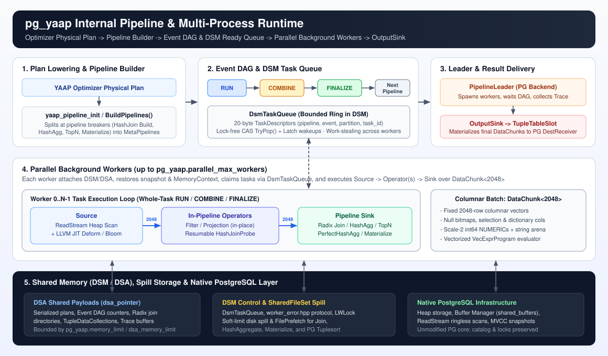

# Pipeline Runtime Architecture



`src/executor/engine/parallel/pipeline/` executes optimizer-owned physical plans lowered via `yaap_pipeline_init` / `yaap_opt_translator*`.

## Pipelines & Event DAG

A pipeline runs `Source -> Operator(s) -> Sink` on `DataChunk<2048>` batches inside an executor process. Blocking operators (`HashAggregate`, `HashJoin` build, `Order`, `TopN`, `Materialize`, `OutputSink`) split the plan into producer and consumer pipelines.

Each pipeline registers three events (`event_id = pipeline_id * 3 + {0, 1, 2}`):

```text
RUN -> COMBINE -> FINALIZE -> dependent pipeline's RUN
```

`TaskScheduler::BuildEvents()` validates acyclicity, bounds, and terminal coverage before launching workers. An elected scheduling worker advances completed phases and releases successor dependencies via shared DSA state; zero-task stages advance inline.

## Process & Cross-Process State Ownership

The PostgreSQL query backend acts as **Leader** (`worker_index = -1`), spawning up to `pg_yaap.parallel_max_workers` dynamic background workers (`0..N-1`) per query (no persistent worker pool; at least 1 worker is required). Workers attach DSM/DSA, restore the leader snapshot, reconstruct local `PhysicalOperator` trees, and drain tasks until query shutdown.

| State | Storage / Scope |
|---|---|
| `PipelineSharedControl` & `DsmTaskQueue` | DSM (`shm_toc` keys `0xD8...`) |
| Event DAG, serialized plan descriptors, shared breaker payloads & TDCs | DSA (`dsa_pointer` published on descriptors) |
| Spilled partitions / blocks | Query-scoped `SharedFileSet` |
| `PhysicalOperator`, `ExecCtx`, `DataChunk`, local sinks | Process-private (`ExecCtx::mcxt`) |

**Cross-process rule:** `Global*State` structs are process-local wrappers, never shared C++ objects. Shared payloads are resolved through descriptor-published DSA handles (`pipeline_descriptor.cpp`, one `dsa_allocate0` per payload), never `palloc` or STL pointers.

## Global Queue & Whole-Task Execution

- **`DsmTaskQueue`:** Single bounded ring in DSM protected by 64-bit CAS cursors and per-cell `pg_atomic_write_membarrier_u64` / `pg_atomic_read_membarrier_u64` sequences. Any idle worker can claim any ready `RUN`, `COMBINE`, or `FINALIZE` descriptor (`task_index` identifies the logical partial slot independently of `worker_index`).
- **Whole-task RUN & `FinishLocalSink()`:** A worker executes a claimed RUN from first chunk to EOF, then seals/publishes process-local state in `FinishLocalSink()`. Segmented `HashJoin`, `CrossProduct`, and `Materialize` finish all producer work there (zero-task `COMBINE`); partitioned `HashAggregate` / `PerfectHashAggregate` schedule partition-owned `COMBINE` tasks after the RUN barrier.
- **Error protocol (`worker_error.hpp`):** CAS `NONE -> WRITING` claims the 512-byte diagnostic buffer, publishes `READY` with a barrier, and triggers query-wide shutdown.

## Core Operators & Current Limits

- **Scan (`PhysicalSeqScan`):** Parallel atomic block pool over PostgreSQL `ReadStream` + buffer manager (`SO_ALLOW_STRAT`), paired with optional LLVM JIT tuple deformation (`pg_yaap.jit_deform`).
- **Hash Join (`PhysicalHashJoin`):** Supports `INNER`, `LEFT`, `RIGHT`, `SEMI`, `ANTI`, `MARK`, and `SINGLE` joins; multi-worker equality joins use radix-partitioned Hybrid Hash Join (batches bounded by `memory_limit`, recursive repartitioning on oversized partitions, spill/prefetch via `SharedFileSet`, and runtime Bloom + Min/Max filter pushdown).
- **Aggregate / Top-N / Sort / Output:** Partitioned `HashAggregate` + direct-mapped `PerfectHashAggregate`, `LWLock`-merged `TopN`, single-threaded `PhysicalOrder` (`MaxThreads = 1`, PG `tuplesort` with spill), and single-reader `OutputSink::EmitGlobalTdcToDest()` drained by the Leader after worker shutdown.
