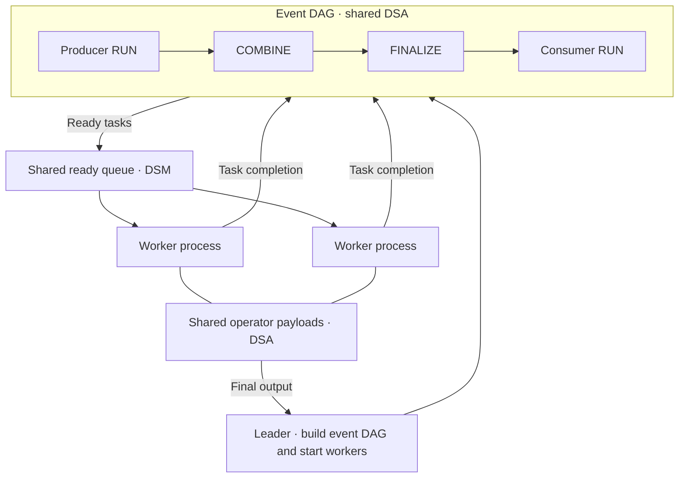

# Pipeline runtime and process communication

This document describes the current runtime under
`src/executor/engine/parallel/pipeline/`. The supported input is the optimizer-owned
YAAP physical plan lowered by `yaap_pipeline_init` / `yaap_opt_translator*`.
Legacy PostgreSQL-plan translation is not the supported execution architecture.

## Pipelines and event dependencies

A pipeline executes `Source -> Operator(s) -> Sink` within one executor process.
Its columnar chunks currently hold up to 2048 rows. Intermediate operators in the
same pipeline call one another locally; they do not send each chunk through IPC.
Blocking operators split the plan into producer and consumer pipelines. For
example, an aggregate is the producer's sink and the consumer's source:

```text
SeqScan -> HashAggregate  -- finalized shared aggregate -->
HashAggregate -> Order   -- finalized shared sort ------->
Order -> Output
```

The leader builds three events per pipeline:

```text
RUN -> COMBINE -> FINALIZE -> dependent pipeline's RUN
```

`BuildEvents()` assigns `event_id = pipeline_id * 3 + {0, 1, 2}`, coalesces
duplicate edges and validates the graph before launch. The query DSA holds the
successor lists and remaining dependency counts. After the ready handshake the
leader publishes the start flag. Workers activate roots and all dependent stages.
Independent pipelines can run concurrently within operator limits and the
query-wide admission of partition-probe working sets.

## Process and state ownership

The query's PostgreSQL backend is the leader. It requests up to
`pg_yaap.parallel_max_workers` dynamic background workers for that query.
Scheduling uses the number that could register and report readiness. At least
one background worker is required. Workers attach DSM/DSA, initialize database
connections, restore the leader's snapshot and reconstruct their own operators
before reporting readiness. They can claim work across pipelines until shutdown.

| State | Ownership and addressing |
|---|---|
| Event DAG and dispatch backlog | Shared DSA phase state and dispatch cursors |
| Physical operators and task objects | Separate objects in each executor process; allocated under its query MemoryContext |
| RUN cursors, chunks and local sink state | Private to the complete RUN task that the process claimed |
| Global ready queue and query control block | DSM, located through `shm_toc` keys |
| Serialized plan, event counters, shared operator payloads and intermediate data | DSA, addressed with `dsa_pointer` and mapped with `dsa_get_address()` |
| Spilled operator data | Query-scoped `SharedFileSet` and shared storage metadata |

Process-local `Global*State` objects are wrappers, not shared C++ objects. Their
shared payloads must be discovered through descriptor-published DSA handles.
An operator that occurs as both producer sink and consumer source publishes its
payload to all relevant descriptor slots. Ordinary pointers, STL objects and
virtual-method tables must never be used as cross-process payloads.

Workers claim all RUN, COMBINE and FINALIZE tasks from the shared queue.
Physical worker indices are `0..N-1`. The leader uses `-1` for profiling and
diagnostics. It builds the graph, starts and monitors workers, and delivers output.

A descriptor's `task_index` is a logical task identity. RUN partial-result slots
are indexed by that identity independently of the claimant's process index. A
process can finish one RUN and then claim another RUN of the same pipeline;
each RUN has fresh private execution state and a distinct shared partial slot.
The slots accommodate the ready worker cohort.



## Task dispatch: one global shared ready queue

`DsmTaskQueue` is one bounded ring in DSM. A scheduling worker publishes a task
and any idle worker may atomically claim it with `TryPop()`. Queue capacity is
a power of two and applies globally. The 20-byte descriptor carries pipeline,
event, partition, logical task and task-kind IDs; it contains no task pointer or
target process ID. A slow or busy worker does not reserve tasks in a private lane.

The queue uses 64-bit cursor CAS and per-cell sequence numbers. The successful
consumer CAS exclusively claims the next descriptor. Explicit publication and
reclamation barriers protect its non-atomic contents:

1. The producer acquires a cell's free sequence before reusing it.
2. It writes the complete descriptor, then publishes the ready sequence using
   `pg_atomic_write_membarrier_u64()`.
3. A consumer acquires that sequence before claiming and reading the descriptor.
4. After copying it, the consumer publishes the cell's next free sequence with
   a memory barrier so reuse cannot overwrite an unfinished read.

Ordinary `pg_atomic_read/write_u32/u64()` do not provide these ordering guarantees.
The current membarrier operations provide full barriers, stronger than the
required release/acquire ordering.

Publication and task completion wake workers through PostgreSQL latches. A worker
resets its latch before checking the shared predicates and waits only when there
is no actionable work. The scheduling worker fills the bounded queue without
waiting for space. Remaining work is represented by the next logical task index
in each event. No process owns a private backlog.

## Whole-task execution and completion

A process that claims a RUN executes it to completion, driving source,
operators and sink over as many chunks as needed. Cursors and local sink state
belong to that task. Chunk-level interrupt/shutdown checks remain active; a task
is not split into scheduler slices or returned to a private continuation queue.
Operators can still produce several chunks for one input chunk internally.

Before a successful RUN completes, `FinishLocalSink()` performs the sink's
process-local finishing work. Segmented hash join seals and publishes its
private writers there; cross product finishes its local build contribution.
Materialize and probe sinks likewise seal their task-local writers before RUN
completion, so no later task needs those private C++ objects.
Their separate COMBINE events therefore have zero tasks. Flat partitioned hash
join and hash aggregation keep post-RUN COMBINE tasks that consume the shared
partial registry. Perfect-hash aggregation has one registry-consuming COMBINE.
A separately claimed COMBINE/FINALIZE may run in a process that never ran that
pipeline and initializes its wrappers from shared descriptors.

A worker finishing a task publishes its outputs before decrementing the shared
task count. The elected scheduling worker acquires completion, releases any
RUN inputs, marks the stage finished and then releases its successor edges.
Zero-task phases advance in the same scheduling pass. The leader reads the
query-wide remaining event count and receives a notification when it reaches zero.
Timeline JSON records the worker that activated and completed each phase.

A CAS elects one worker for a scheduling pass, which serializes shared payload
initialization and graph updates. The owner registers the entire logical task
count before first publication. `tasks_in_flight` includes queued, claimed and
running tasks, and `max_concurrency` limits admission. The scheduling pass never
waits for queue capacity or holds the election while executing a claimed task.
Errors end the query through the shared error protocol.

Hybrid probe RUNs retain their fixed logical participant cohort. Participant
indices come from the RUN task index. Workers continue publishing descriptors as
queue space becomes available. Query-wide hybrid admission limits overlapping
probe working sets.

## Operator-owned stage plans

Sink operators provide `GetCombineTaskPlan()` and `GetFinalizeTaskPlan()`.
Their `SinkTaskPlan` describes:

- The number of tasks
- The maximum participating executors
- Whether tasks own partitions

Operators own their payload layouts, partition counts and memory-based
concurrency calculations. The scheduler validates the plan, applies its
event publication quota, and expands it into freely claimable descriptors. For example, hash aggregation can combine partitions and
segmented hash join can finalize partition directories with bounded concurrency.
Ordinary finalize is a single unpartitioned task. Any ready worker can run it. Zero-task stages release dependencies inline.

RUN parallelism is separately bounded by available executors and every operator's
`MaxThreads()`. A source must explicitly implement `ParallelSource()` and safe
work ownership to fan out; a source without that capability caps RUN at one.
Adding workers therefore does not make every pipeline parallel.

Startup reservations account for the ready worker cohort. Hash aggregate
divides initial row/hash-table capacity across partitions and producers within a
fraction of the query budget, then grows on demand. Hash join bounds radix fan-out
and RUN concurrency by the active key/payload tails that cannot be evicted by
another process.

## Error publication and teardown

`worker_error.hpp` implements a first-writer-wins protocol:

```text
NONE -- CAS claims buffer --> WRITING -- complete message + barrier --> READY
```

`WRITING` is already a reason to stop execution, but its diagnostic buffer is not
readable. `WorkerErrorMessage()` acquires `READY` before returning the immutable
message. Competing reporters cannot overwrite it. If the reporting process dies
before publication, the leader can fail with a generic diagnostic instead of
reading partial text or waiting forever. Worker errors retain task kind,
pipeline, partition and available PostgreSQL error details.

Workers observe shutdown/error state between tasks, and RUN checks shutdown and
interrupts while processing chunks. The leader also detects unexpected worker
exit. Teardown requests shutdown, wakes workers, waits or terminates as needed,
and then releases shared resources. Successful completion explicitly wakes idle
workers for shutdown before the leader drains output.

## Current limits

- `PhysicalOrder::MaxThreads()` is 1. Existing sorting uses PostgreSQL tuplesort
  and can spill, but there is no parallel sort in this runtime.
- Sources without explicit parallel work ownership cap their pipeline at one
  executor, even if upstream construction used several workers.
- Output finalization materializes ordered rows or a sorted row index when
  needed. The leader drains shared results through
  `OutputSink::EmitGlobalTdcToDest()` after event completion and worker shutdown.
- Workers start per query; short queries pay connection, snapshot and plan
  reconstruction costs. This change does not introduce worker pooling.
- Once claimed, a complete task runs in that process until it finishes or errors.
  This is not preemptive scheduling and does not impose a hard latency bound on
  an individual operator call.

## Code and verification entry points

- `physical_operator.cpp`, `meta_pipeline.cpp`: pipeline construction.
- `task_scheduler.cpp`: graph validation (cycle, bounds, terminal coverage, shared-sink guard), dependency progression and dispatch.
- `dsm_task_queue.cpp`: the global shared ready queue and its publication protocol.
- `pipeline_leader.cpp`, `pipeline_worker_main.cpp`: executor process loops.
- `pipeline_descriptor.cpp`, `worker_error.hpp`: shared handles and diagnostics.
- `physical_top_n.cpp`, `physical_cross_product.cpp`, `physical_hash_join.cpp`: `LWLock` + `PG_TRY`-guarded shared combines; task-local Top-N candidate tracking for `max_rows <= 4096` merged once in `FinishLocalSink`.
- `physical_delim_scan.cpp`: spillable/reloadable `PhysicalMaterialize` segments retired after the last consumer pipeline finishes RUN.
- `tests/pipeline_task_queue.cpp`: real PG atomics with forked shared-memory
  consumers, arbitrary idle-worker claiming, exact-once delivery and descriptor
  publication/reuse stress.
- `tests/pipeline_error_protocol.cpp`: paused diagnostic writer and competing
  writer checks across processes.
- `tests/pipeline_event_dag.cpp`: production `TaskScheduler` + `DsmTaskQueue`
  Event DAG validation (cycles, invalid deps, shared-sink guard), deep zero-task
  chains, duplicate-edge coalescing, 4-process diamond/fan-in/fan-out on a 2-slot
  queue, and abort blocking successor release.
- `tests/pipeline_scheduling.py`: complete logical task identities and exactly-once
  completion independent of physical worker assignment, plus result comparisons.
- `tests/pipeline_stage_plans.py`: aggregate, actual perfect-hash, join,
  cross-product and independent-branch stage plans with the probe switch.
- `tests/pipeline_stage3_4.py`: concurrent TopN/CrossProduct LWLock safety,
  low-budget Materialize spill/reload/retirement, hybrid partial startup (`ready=1`),
  PG `EXPLAIN`/cursor lifecycle boundaries, and client-disconnect leak checks.
