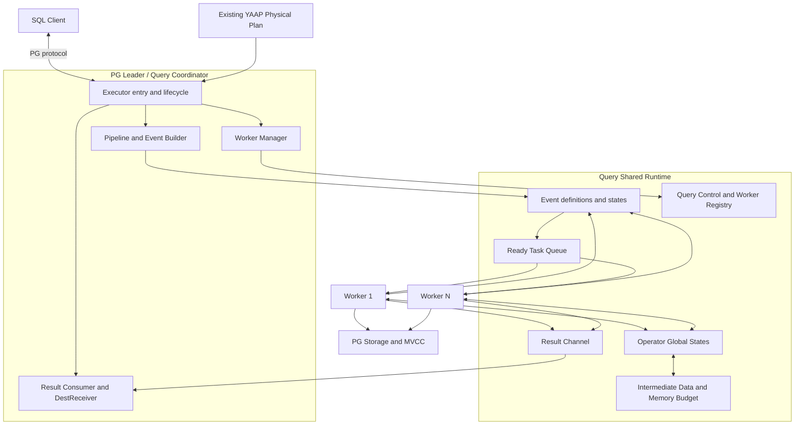
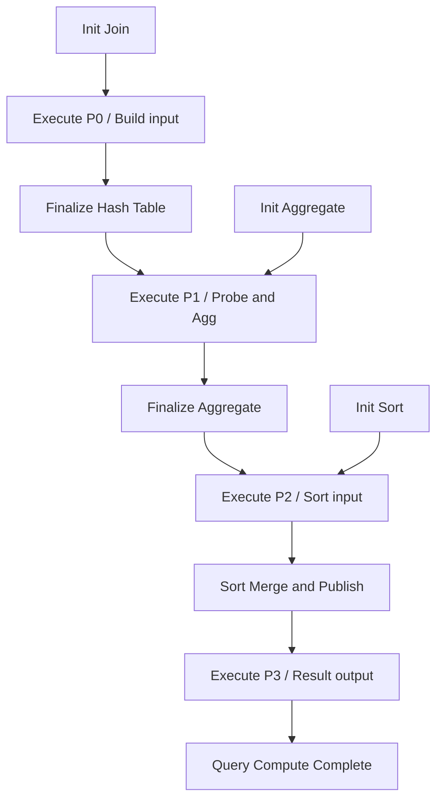
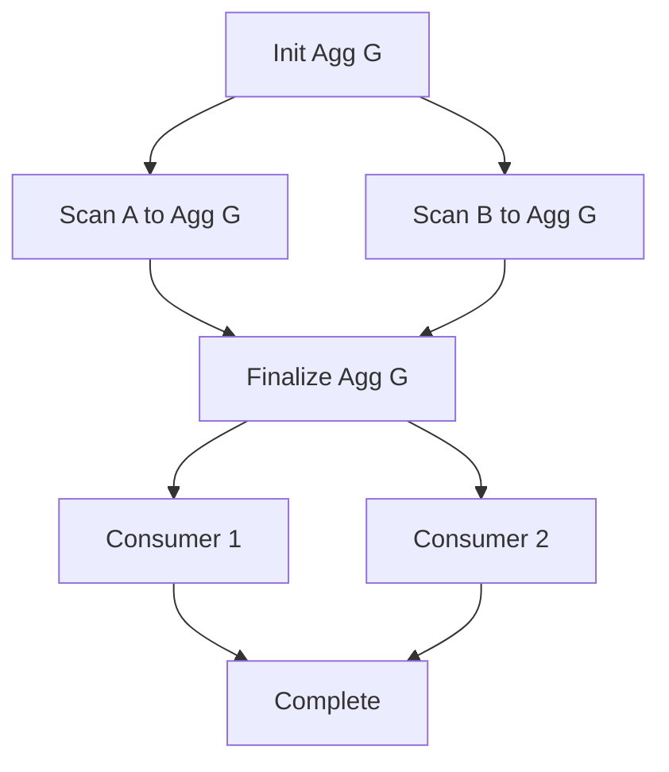
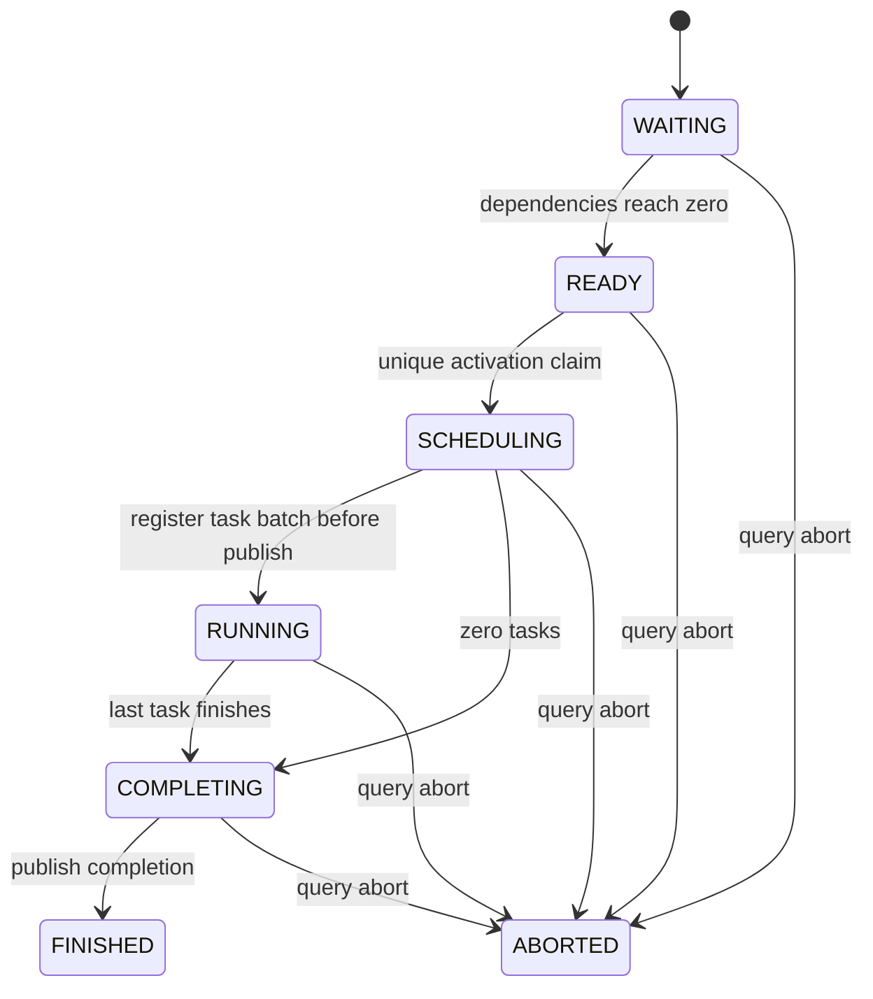
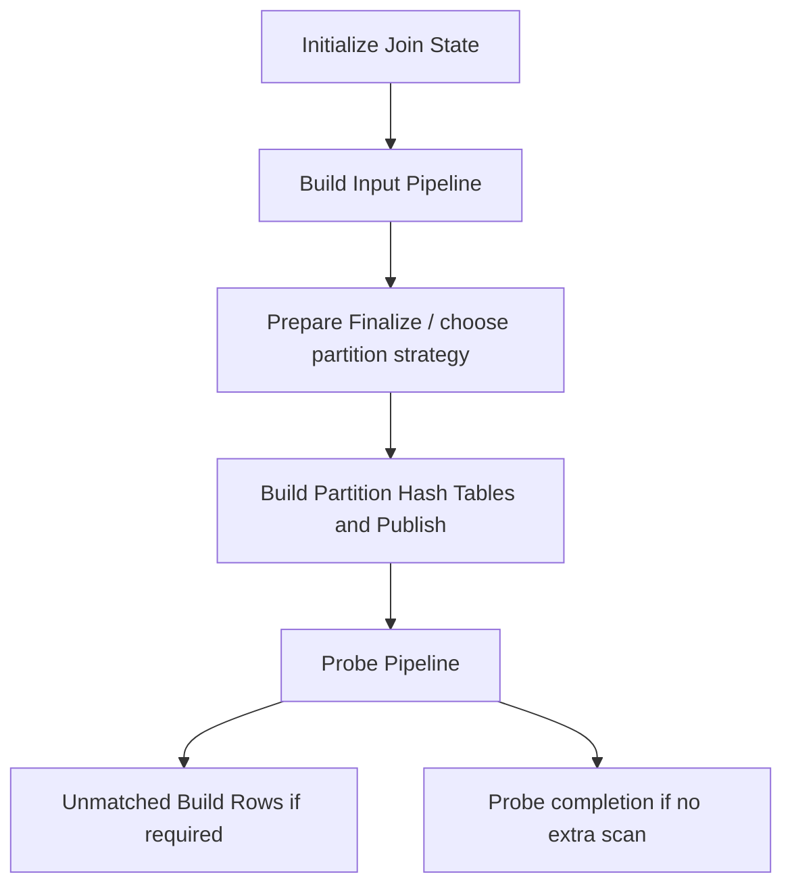

# pg_yaap 执行器概要设计

**主题：基于 Event DAG 的多进程向量化执行框架重构**  
版本：v0.1 · 目标架构评审稿  
适用对象：pg_yaap 执行器开发者、代码审查 Agent  
参考实现：DuckDB v1.5.0；宿主环境：PostgreSQL

> 本文描述目标设计（To-Be），用于与 pg_yaap 当前代码（As-Is）进行对照和差距分析，不是对现有代码的完整审计，也不是新建独立执行器的需求。优先复用现有模块，不要求机械照搬 DuckDB 的类、文件或算法。

## 0. 架构决策摘要

| ID | 决策 | 约束 |
|---|---|---|
| D01 | 在现有 pg_yaap 内重构 Executor | 不另建项目，不移植 DuckDB 源码 |
| D02 | 输入为已有 YAAP Physical Plan | Planner、优化及 Plan lowering 的具体实现不在本次范围；保留现有桥接路径 |
| D03 | Pipeline 描述计算路径 | Source → Operator(s) → Sink；不持有独立的运行时依赖图 |
| D04 | Event DAG 是唯一的执行依赖权威 | 节点为 Event，边为先决 Event → 后继 Event；Task 不属于图节点 |
| D05 | Query 级固定 Worker 进程池 | 启动一次、跨 Pipeline 复用，实际数量以成功启动者为准 |
| D06 | Leader 不参与任何算子 Task | 负责初始化、PG 上下文、进程管理、结果消费及清理 |
| D07 | Worker 自主推进 Event | 无独立调度进程；Leader 不负责常规后续 Task 的分发 |
| D08 | Task 与 Morsel 分离 | Task 是调度单位，Morsel 是动态领取的数据单位 |
| D09 | 共享状态与私有对象分离 | 共享可跨进程访问的状态及数据，不共享任意 C++ 对象 |
| D10 | 计算阶段独占写入、发布后消费 | 优先减少共享写竞争，不要求所有算子都采用同一种算法 |
| D11 | Query 级统一内存预算及 Spill | 复用现有内存系统；共享内存布局和分配实现暂不设计 |
| D12 | 查询失败即整体终止 | 不支持 Task 重试和 Worker 故障接管；已由 YAAP 接管的查询不得静默回退 |

## 1. 背景、目标和范围

### 1.1 现有系统与本次动机

pg_yaap 已有自己的优化器、列式执行器和 PG 集成。公开 README 与 AGENTS.md 描述了 Pipeline、MetaPipeline、PipelineLeader、TaskScheduler、DataChunk、向量化表达式/JIT、并行扫描、Hash Join、聚合和排序等能力；也记录了 `pg_yaap.parallel_leader_participation` 配置。[R1][R2]

这些信息说明本次工作应当关注执行框架的组织和调度协议，而不是重新实现所有算子。公开仓库说明可能落后于代码；本文没有取得完整源码树逐行核对，不能由此断言现有实现一定缺少 Event、一定按阶段启动进程、一定存在 Leader 瓶颈或一定缺少 Spill。Agent 应以实际 checkout 的 commit 为准。

目标是减少 Leader 对计算进度的介入，让独立可执行阶段能够被任意 Worker 调度，统一多阶段算子的依赖表达，并明确跨进程同步、数据所有权和错误传播。性能提升属于待验证目标，不预设收益。

### 1.2 范围内

- Executor 入口、Query 生命周期及现有 PG hook 接入关系。
- Physical Plan 到 Pipeline 定义和初始 Event DAG 的构建（不是 SQL Plan Converter）。
- Event 状态机、依赖释放、Task 生成、队列、Worker 调度、等待和终止。
- PipelineExecutor、Source/Operator/Sink 接口契约及 Global/Local State 生命周期。
- 共享控制状态、跨进程中间结果、计算内存管理和结果通道的逻辑设计。
- 以 Scan、Join、Aggregate、Sort、Limit、CTE 等说明调度需求；保留现有正确的算子算法。
- 正确性、可观测性、性能验证、迁移和 Agent 对照要求。

### 1.3 范围外

- Parser、Binder、Planner、Cost Model、Join Order、统计信息估计和物理计划生成；既有优化器保持工作。
- 具体 DSM/DSA 布局、共享指针表示、Allocator、队列的数据结构实现、锁的底层封装与 ABI。
- PostgreSQL 持久化存储、事务管理、WAL、Buffer Pool 的重写；DuckDB 源码移植。
- 分布式 MPP、跨 Query 常驻 Worker Pool、Task 失败重试、动态执行进程扩缩容。
- 第一阶段不新增递归 CTE、通用参数化执行、复杂游标/Rescan 等能力；已支持功能须保留旧路径或先形成等价方案，不允许无提示回归。

### 1.4 设计优先级

正确性（SQL 语义、MVCC、数据发布、取消） > 生命周期可控 > 调度可验证性 > 并行性能 > 调度算法复杂度。第一版允许保守的串行 Event、互斥队列或物化边界，不为 lock-free 或动态 DAG 牺牲正确性。

## 2. DuckDB 参考与 YAAP 的差异

本文固定参考 DuckDB v1.5.0，避免把 main 分支的变化当作稳定接口。DuckDB 在 Pipeline/MetaPipeline 层记录依赖，由 Executor 构建更细的 Event 图；例如普通 Pipeline 依赖会映射到对前驱 Complete Event 的依赖，而 MetaPipeline 内部的某些约束则对应 Execute Event 之间的依赖。它还可为 Join Build 的内存决策安排额外阶段。[R3]

DuckDB 的 Event 通过任务计数和依赖计数推进调度，后续阶段可插入新的 Event。[R4] Pipeline 的并行 Task 数量按 Source、Operator、Sink 能力和可用执行线程等确定，不等于数据页数量。[R5] 客户端调用线程也可能直接执行 Task，常规后台计算线程不是唯一计算者。[R3][R6]

| 维度 | DuckDB 参考 | YAAP 目标 |
|---|---|---|
| 并行载体 | 共享地址空间中的线程 | PG Worker 进程 |
| 调度图 | Pipeline 依赖及派生的 Event 图 | 直接生成唯一 Event DAG；允许构建期临时依赖信息 |
| 前台执行 | 调用线程可以参与 Task | PG Leader 不执行 Task |
| 调度范围 | 数据库实例调度器及查询相关任务 | 每条 Query 独立调度状态 |
| Global State | 可使用共享地址空间中的普通对象 | 明确的跨进程可访问数据和私有访问对象 |
| 存储 | DuckDB 的存储接口 | PG Table AM / Heap / MVCC |
| 动态调度扩展 | 支持插入 Event 等 | 第一阶段采用冻结拓扑及动态 Task 数；后续再扩展 |

不维护 Pipeline DAG 不等于没有 Pipeline 之间的数据依赖。Pipeline 之间的依赖仍存在，只是统一在 Event 图表达。若现有 MetaPipeline 还承担共享 Sink、顺序、递归或其他语义，可保留作为构建期 grouping abstraction，不需要为了删类名而丢失语义。

## 3. 总体架构



图中为组件关系图，存在运行时反馈边，**不是 Event DAG**。只有 Event 依赖图必须满足有向无环约束。

逻辑组件：

| 组件 | 主要职责 | 执行位置 |
|---|---|---|
| QueryCoordinator | 初始化、监管、结果转发、终止 | Leader |
| PipelineBuilder / EventBuilder | 生成计算路径、依赖图并验证 | Leader |
| EventManager | 激活 Event、处理 Task 完成和后继依赖 | Worker；Leader 仅启动初始 Event |
| TaskScheduler | Ready Task 入队/领取、等待及通知 | 共享状态 + 各进程调用接口 |
| WorkerManager | 启动 PG Worker、确认实际数量、监测退出 | Leader |
| TaskExecutor | 按类型执行 Pipeline 或独立计算阶段 | Worker |
| PipelineExecutor | 批处理数据流、局部状态、Flush、Combine | Worker |
| Operator System | 各算子逻辑及 Global/Local 状态协议 | Worker 为主 |
| Memory System | 预算、Block、Spill、引用生命周期 | 共享协调 + 进程私有操作接口 |
| Result Channel | 生产、顺序、背压、EOS | Worker 生产，Leader 消费 |

TaskScheduler 是被调用的逻辑组件，不是一个常驻的调度进程。运行时不要强制所有 Worker 的任务完成都经由 Leader 转发。

## 4. 核心抽象与接口

以下为语义伪代码；类名、容器和字段不规定当前 C++ ABI 或共享内存布局。

### 4.1 Physical Plan 与 Pipeline

输入已由 YAAP Planner 提供。Executor 负责确认运行所需的 schema、表达式、算子能力、参数与顺序要求完整；PG 权限、事务和并行安全必须遵守现有契约。当前 optimizer → executor lowering 如果存在，则保持为边界适配，而不是本次新增 Plan Converter。

```cpp
struct PipelineDef {
    PipelineId id;
    OperatorId source;
    List<OperatorId> operators;
    OperatorId sink;
    PipelineProperties properties; // schema, ordering, parallel capability
};
```

PipelineDef 是只读的，描述一条 Source → Operators → Sink 计算路径。同一 PhysicalOperator 可在不同 Pipeline 扮演不同角色（如 Join Build Sink、Probe Operator、未匹配行 Source）。Pipeline 不保存独立的调度依赖计数，不负责启动 Worker。

### 4.2 Event 与 Event DAG

Event 是一次具有先决条件的执行阶段。Event 可以关联 Pipeline、算子、一个共享 Sink group 或整个 Query。一个 Pipeline 可关联多个 Event，一个 Finalize Event 可依赖多个 Pipeline 的 Execute Event。

定义 G=(V,E)：V 为 Event 实例集合；有向边 `(u,v)` 表示 u 已成功完成并发布其约定数据，v 才可开始。所有输入边均需满足（AND 语义）。边不是数据传输队列，不承载 DataChunk。v 的入度决定初始剩余依赖数；出边用于通知后继。没有环不代表资源等待不会死锁，后者单独验证。

```cpp
struct EventDef {
    EventId id;
    EventType type;
    EventTarget target;  // PipelineId / OperatorId / SinkGroupId / Query
    List<EventId> successors;
    uint32_t indegree;
};
struct EventState {
    EventStatus status;
    uint32_t remaining_dependencies;
    uint32_t total_tasks;
    uint32_t remaining_tasks;
};
```

Event 类型建议：Initialize、PipelineExecute、PrepareFinalize（可选）、Finalize、Merge/BuildPartition、Complete、QueryComputeComplete。它们是阶段类型，不要求为每条 Pipeline 机械创建固定数量的节点。

### 4.3 Task 与 Morsel

Task 是一次可被调度、完成计数一次的工作。TaskDesc 可跨进程传递；实际执行上下文在领取它的进程构建。

```cpp
struct TaskDesc {
    TaskId id;
    EventId event_id;
    TaskType type;
    TaskPayload payload; // PipelineId / partition / merge range / state IDs
};
```

Morsel 是 Source 分配的数据范围（PG block range、partition、run range 等），一个 Pipeline Task 可循环处理多个 Morsel。不为每一页或每一批 DataChunk 建立 Task。`total_tasks` 由 Event 激活时决定，与 Planner 估计的数据页/行数没有正确性依赖。

Task 类型包括 PipelineTask、InitTask、PrepareFinalizeTask、HashBuildTask、AggMergeTask、SortMergeTask、PublishTask 等；独立 Task 可不关联 Pipeline。

### 4.4 PipelineExecutor 和算子接口

PipelineExecutor 是 Task 私有对象，负责按批执行；Global State 通过稳定 ID 获得本地访问对象。已有 `next_batch`、表达式程序及 DataChunk 可保留，接口语义对齐比改名重要。

```cpp
SourceResult GetData(GlobalSource&, LocalSource&, DataChunk& out);
OperatorResult Execute(GlobalOp&, LocalOp&, const DataChunk& in, DataChunk& out);
SinkResult Sink(GlobalSink&, LocalSink&, const DataChunk& in);
void Combine(GlobalSink&, LocalSink&);
// PlanFinalize / Publish describes follow-up work; data is ready only on event completion.
```

需要表达 HAVE_DATA、NEED_INPUT、HAVE_MORE_OUTPUT、FINISHED、BLOCKED（若支持）和错误，不能把空 Chunk 一律当 EOF。Join 可能一个输入批次产生多个输出批次；具有缓存的算子必须 Drain/Flush；Sink 可能只接受部分输出，必须保留游标或明确未消费的数据。

## 5. Pipeline 和 Event 图构建

### 5.1 构建流程

1. 遍历已有 Physical Plan，识别算子角色及 pipeline breaker，分配稳定的 OperatorId、PipelineId。
2. 构建 PipelineDef，登记各阶段使用的 Global State、Sink group、数据生产者及消费者。
3. 直接构造 Event DAG：为必要的 Init、Execute、Finalize、Publish 等阶段建立 Event，依据数据依赖、初始化依赖、共享 Sink 依赖、顺序约束连边。
4. 为每个 Sink group 验证所有生产者已纳入 Finalize 的先决条件；多消费者各自拥有正确的 Source cursor。
5. 添加 QueryComputeComplete 终点，覆盖所有必要终态（不只 root 输出 Event）；校验 ID、重复边、入度、环、终点可达性以及输入输出契约。
6. 冻结初始图；将定义和运行时状态准备就绪后发布给 Worker。首版不在执行中改变已有边或入度。

可使用临时 PipelineDependency 列表或保留现有 MetaPipeline 在构建期辅助连边；运行时只保留 Event 依赖作为唯一权威。不可让两个调度器分别维护 Pipeline 和 Event 完成状态。

### 5.2 示例：Join + Aggregate + Sort

```text
P0: Scan B -> HashBuildSink(J)
P1: Scan A -> HashProbe(J) -> AggSink(G)
P2: AggSource(G) -> SortSink(S)
P3: SortSource(S) -> ResultSink(R)
```



此图是示意的 Event DAG（节点为阶段，P0 等只是引用）。E0 完成只代表扫描与 Combine 完成；F0 完成才表示 Join 数据可 Probe。Init 可在其输入未就绪时执行的前提是它不读取尚未发布的数据且预算允许。

### 5.3 示例：共享 Sink 与扇入/扇出



同一 Sink group 只初始化、Finalize 一次（除非显式定义多个 epoch）。此例中 C1/C2 是可独立消费同一份物化结果的示意，不能共享一个会耗尽的数据游标，除非语义确实要求分工消费而非各自完整扫描。若有顺序要求或不可并发的 Sink，应加依赖或限制并行度。

## 6. Leader / Worker 职责及 Query 生命周期

### 6.1 Leader

Leader 是 PG 客户端连接对应的 backend。目标模式下它不领取 PipelineTask、不扫描、不 Join/Agg/Sort、不执行计算 Finalize，也不承担结果流的比较/归并排序。允许必要的 PG 结果编码、Datum/TupleSlot 转换和 DestReceiver 调用，这属于协议适配而非 AP 算子计算。

Leader 负责：接收 Plan，建立和验证 Event 图；建立 PG parallel transaction/snapshot 所需上下文及资源；创建共享 Query Context；启动 Worker 并确认可用数量；提交初始 Event；并行运行期间消费结果、处理取消及 Worker 错误；结束时等待 Worker 退出并清理。

Leader 触发初始 Event 的含义是发布可执行的 activation/initial task，不是在 Leader 内同步执行算子 Init/Finalize 回调。涉及 PG 仅 Leader 可做的操作必须在进入并行阶段前准备好，或明确定义非计算的控制请求；首版不通过隐藏的 Leader-only 算子 Task 绕过此决策。

### 6.2 Worker

每个 Worker attach 同一 Query Context，恢复 PG 允许在并行模式使用的事务和 snapshot 状态，重建自身只读计划及私有运行上下文。其后主动领取任意 Ready Task，完成局部处理，发布数据，推进 Event 并唤醒其他 Worker。Worker 不绑定 Pipeline，Query 级 pool 不因 Pipeline 切换而重启。

### 6.3 启动与终止状态

```text
INITIALIZING -> STARTING_WORKERS -> RUNNING -> COMPUTE_DONE
                                                    |
                                                    v
                                   RESULTS_DRAINED -> JOINING -> FINISHED

任意非终态 -> ABORTING -> JOINING -> FAILED / CANCELLED
```

上述为逻辑生命周期，结果消费可以从 RUNNING 开始，`compute_done` 与 `result_drained` 可使用独立标志，不能假设两者总按固定时序被观察。结果 EOS 的发布必须先于最终 drained 判定。只有所有 Worker 已停止访问资源后才回收共享上下文。

启动时使用实际 ready Worker 数 N，而非请求值。N=0 时，已由 YAAP 接管则报明确错误并清理；是否在接管前拒绝查询由现有 admission 策略决定。N=1 是必须支持的执行场景，所有同步协议不能依赖多个 Worker。若部分 Worker 启动失败但剩余可正常运行，允许降低并行度；已开始执行的 Worker 异常退出则整条 Query 失败。

### 6.4 PostgreSQL 集成契约

复用当前 PG hooks、Parallel Context 及已有进程基础设施。PG 原生 Parallel Plan 是否生成是外部 Planner/接入策略，不是执行调度的前提。不要把 `max_parallel_workers_per_gather` 当作 YAAP Worker 的调度接口；也不将 PG Gather 当作必要算子。[R7]

所有 Worker 必须使用与查询一致的 snapshot，遵守 relation lock、MVCC、执行权限、PG parallel-safety 和资源管理约束。Leader-only 数据如临时表、非 parallel-safe 函数、会话相关对象不能直接交给 Worker。PG ERROR/longjmp 与 C++ 对象生命周期交界需沿用或完善当前 bridge 清理协议；不能仅依赖析构函数释放共享锁、pin 或临时文件。

## 7. Event 调度协议（核心）

### 7.1 状态机



`FINISHED` 表示该 Event 的合同已满足，不一定表示整个 Pipeline 完成。若 Finalize 是独立后继 Event，则 Execute Event 不负责其工作。Event 完成后所有后继都必须收到一次依赖释放；在释放期间不能提前宣告 Query 全局终止。失败/取消是 Query 级终止，不视为成功依赖。

### 7.2 激活与任务发布

```text
ReleaseDependency(v):
    atomically decrement remaining_dependencies(v)
    if previous value == 1:
        transition WAITING -> READY exactly once
        publish ActivationTask(v)

Activate(v):                     # 由 Worker 执行
    claim READY -> SCHEDULING exactly once
    prepare finite task batch (including zero)
    set total_tasks, remaining_tasks
    if batch empty:
        complete v using zero-task path
    else:
        publish RUNNING state and all counted tasks
        wake available workers
```

ActivationTask 是调度控制描述符，不计入目标 Event 的计算 Task 数；它只负责建立任务批次，也可由完成前驱的 Worker 在安全边界同步执行等价的轻量调度步骤。初始 Event 直接从 WAITING 转 READY 并发布 activation，不对零依赖计数执行 decrement。

所有待计数 Task 必须在其可被领取前注册；不能先入队再填写 total_tasks。任务可见性和计数发布必须建立 happens-before 关系。入队失败不是跳过工作，而是 Query abort。

### 7.3 Task 完成与后继触发

```text
FinishTask(t):
    require t is RUNNING and owned by caller
    flush/Combine/publish outputs required by the task contract
    transition task RUNNING -> DONE exactly once
    old = atomic_decrement(event.remaining_tasks)
    require old > 0
    if old == 1:
        claim event RUNNING -> COMPLETING
        CompleteEvent(event)

CompleteEvent(e):
    validate required outputs and establish publication visibility
    publish FINISHED exactly once
    release every successor dependency exactly once
    update query completion bookkeeping and notify waiters
```

最后完成者不是固定 Worker，通过原子计数或等价互斥协议选举。实现须保证此前所有 Task 的数据写入在完成者和后继消费者看来可见（如正确的 acquire/release 链或锁协议）；不能只使用 relaxed 计数再假设所有数据已可见。后继发布也必须有对应的 acquire 读取。

Zero-task Event（空输入、无需额外合并、纯同步阶段）仍须完成并释放边；不可等待一个不存在的 Task。避免在深 DAG 上无限递归完成零任务链，可使用控制任务队列或迭代 worklist。

### 7.4 静态图与动态任务

首版：Event 拓扑在执行前冻结，但每个 Event 的 Task 数可以在激活时根据实际分区、Run、内存预算和 Worker 数决定。对于多轮 Sort Merge 或 External Hash Join，可由一个阶段 Task 编排其独立有限工作，或预先定义必要阶段并用 zero-task 跳过。若需要真正多轮动态派生，采用后续扩展的 sub-event/subtask 协议，不能在现有 counter 已可能归零后直接追加任务。

推荐后续的动态任务登记协议为 `open_producers + outstanding_tasks + sealed`，或使用独立 child Event；仅在所有生产者关闭且 outstanding 为零时允许阶段完成。动态 Event 插入必须在前驱完成及后继就绪之前原子修改拓扑与计数，验证无环，且不能让已 READY 的后继重新变成 WAITING。第一阶段不实现此复杂能力，迁移现有 spill 算法时若必须依赖它，应单列兼容方案。

### 7.5 Query 计算完成条件

唯一终点 Event 的先决条件覆盖所有计算分支。它完成、所有必要的结果生产者 EOS 已发布、无运行中的调度发布操作且无未完成的可执行工作时，才可声明 `compute_done`。实现可利用终点图不变量或独立全局记账验证；不能只依据队列为空或瞬时 running_tasks==0。

## 8. TaskScheduler 与进程池

### 8.1 并行度与工作划分

PipelineExecute Event 的 Task 数通常 `min(N, source_cap, operators_cap, sink_cap, memory_cap)`，至少一（真正无工作可走 zero-task）；有顺序、资源或算子安全限制时使用一个 Task。Finalize 等阶段也按任务类型独立计算并行度，如 partition merge 可按分区建立多于 N 个小 Task。

Task 数影响并行度，不定义实际数据规模。例如估计仅 10 页而实际扫描范围 100 页，启动 2 个 Task 并不导致只扫描 10 页：每个 Task 动态领取 Morsel，直到真实 Source EOF。PG 表的物理扫描范围应由 Table AM/扫描协议确定，不用优化器 relpages 当作扫描上限；并发关系变化遵循 PG 语义。

### 8.2 队列和 Worker loop

```text
WorkerMain:
    attach and initialize local context
    mark READY
    loop:
        check abort / PG interrupts
        try to resume a ready task owned by this worker (if supported)
        otherwise claim a global ready task
        if task acquired:
            execute and finish (or suspend without finishing)
        else:
            wait for work / termination / resource notification
    release local resources and detach
```

首版可用单个 Query 级 MPMC 逻辑队列，不要求 lock-free。Task claim 应唯一，队列状态和通知协议要避免丢唤醒：先注册等待，再检查共享谓词，确认仍无任务且未终止才休眠。通知不是任务本身，允许虚假唤醒。任务发布不能因为有界调度队列满而让所有 Worker 阻塞在生产者身份；应有非阻塞可增长/溢出或可延迟发布机制，具体实现后定。

多个无依赖 Event 可以同时 READY；是否同时获得 Worker 受调度策略、内存 reservation、顺序等限制。首版 FIFO 或有界批次足够，后续可引入优先级/公平性/临界路径优化。任何优先级都不得让必要的解除阻塞任务永久饥饿。

### 8.3 Task 状态、抢占和阻塞

```text
QUEUED -> RUNNING -> DONE
              |        （DONE 只记账一次）
              +-> BLOCKED -> READY_OWNED -> RUNNING
              +-> FAILED / CANCELLED
```

首版普通 PipelineTask 可 run-to-completion，处理多个 Morsel。禁止等待尚未满足依赖的 Event；这些 Task 根本不应入 Ready 队列。短暂 IO、锁、结果空间等待允许，但须可取消且不持有相关共享锁。

如果算子或结果通道需要 yield，Task 的私有 PipelineExecutor、局部游标和未消费 Chunk 不得直接迁移给其他进程；恢复任务由原 Worker 领取。后续若支持迁移，需显式可序列化 continuation 和所有权协议。对于首版阻塞式执行，应验证所有阻塞者依赖的进度由 Leader、IO 或仍可运行的任务保证；否则改用 yield 或重排资源依赖。

### 8.4 无任务时的进度诊断

区分正常空队列（其他 Task 运行、等待 IO、结果背压）、计算已结束、以及图/资源死锁。记录 ready/running/blocked、待调度 Event 和等待原因；诊断一致快照或超时重查，避免瞬时状态误报。任何 Worker 异常退出由 Leader 的 PG 进程监管发现，不能无限等待其剩余计数归零。

## 9. Global / Local State 与 Pipeline 执行协议

### 9.1 状态分层

| 状态 | 生命周期 | 主要使用者 | 存放原则 |
|---|---|---|---|
| OperatorDef / PipelineDef | Query | 所有相关 Worker | 只读描述可共享或重建私有副本 |
| GlobalSourceState | Source 使用阶段/epoch | 同一 Source 的多个 Task | 共享扫描范围、分发状态、已发布输入描述 |
| LocalSourceState | Task | 当前 Task | 私有 Relation/ScanDesc、当前 Morsel、读取游标 |
| GlobalOperatorState | 算子阶段/Query | 相关 Task | 按需要共享，如已构建 Hash Table、Limit 计数 |
| OperatorState | Task | 当前 Task | 私有 Probe 游标、表达式缓存、输出续点 |
| GlobalSinkState | Sink group/epoch | 多个生产者和 Finalize | 共享发布目录、累计状态及最终数据 |
| LocalSinkState | Task | 当前 Task | 私有局部表/排序辅助状态/独占数据块句柄 |
| PipelineExecutor | Task | 当前 Worker | 私有执行上下文、DataChunk、表达式/JIT 状态 |

Global 指逻辑作用域，不意味着整个类或全部 payload 都必须放入共享内存。Local 指操作所有权，不意味着其产生的全部数据必须位于私有地址空间。局部 Sink 可以从共享计算内存申请独占 Block，写完再发布其描述符。跨进程消费的数据也可以通过共同可访问的 Spill 文件表示，而不必常驻共享 RAM。

### 9.2 Task 执行生命周期

```text
Claim Task
    -> Attach required Global States
    -> Create Local States and PipelineExecutor
    -> GetData / Execute / Sink loop
    -> Drain pending operator output
    -> Flush local sink
    -> Combine / Publish owned data
    -> Release local-only resources and pins as appropriate
    -> FinishTask exactly once
```

一个 Task 每次获取新的 Morsel 前检查取消及下游停止状态。Source 暂时无数据（异步输入）不能被误判为最终 EOF；空批次可能只是过滤结果为空。Task 结束不仅要求 Source 耗尽，还要求所有已领取输入完成计算、算子内部输出排空、Sink 结果已发布。正常提前停止则走明确定义的短路协议。

同一 Worker 可以顺序执行多个 PipelineTask；Local State 默认按 Task 隔离，不得把 Worker ID 当作 Task ID 或把每 Worker 的 slot 当作每 Task 的 slot。若复用 Worker-local allocator/JIT cache，则限定在不改变执行语义且不遗留已完成 Task 的引用的场景。

### 9.3 数据所有权协议

推荐逻辑状态：

```text
ALLOCATED -> OWNED_WRITABLE -> SEALED -> PUBLISHED
                                             |
                                             v
                                READABLE / PINNED -> RECLAIMABLE -> FREED
```

- OWNED_WRITABLE：仅一个 Task/Worker 负责写入，其他进程不得读取未发布内容。
- SEALED：数据格式、有效长度、变长值引用均完整；不能再按原 writable 方式修改。
- PUBLISHED：描述符与数据对消费者可见。并行读取需按合同取得引用/pin。
- RECLAIMABLE：所有后继消费者、回放需求和 pin 都已结束，才允许释放或更改生命周期。
- 共享可变状态（如 Outer Join matched bitmap、内存计数）需显式并发访问协议，不能以发布后不可变的规则掩盖合法修改。

Event 边提供计算阶段之间的数据就绪保证，但不自动保护存储生命周期；Block 仍需所有权、引用、pin、消费完成协议。零拷贝发布是优化目标，不得发布指向原 Worker 私有 arena、栈、PG tuple 内存或其他不可访问地址的引用。

## 10. 各典型算子的阶段与同步设计

以下是目标调度形态，不要求更换现有算子算法；对照时先查现有算子实际的 Build/Probe、Combine、Spill 及输出协议。

### 10.1 SeqScan / Filter / Projection

```text
Init Scan -> Execute Scan Pipeline -> Complete
```

GlobalSourceState 提供实际扫描范围、Morsel allocator、可选的运行时过滤器、停止状态；每个 Task 独立建立 PG 本地扫描对象，动态领取范围，再完成 MVCC 可见性、Deform、Filter、Projection 和 Sink。优先复用现有 PG ReadStream、block pool 及 AIO 路径，不因调度重构丢失预读、pin 生命周期或批处理效率。

共享原子操作优先放在 Morsel 领取而非每 Tuple/Vector。Source EOF 由真实数据边界确定，统计信息只影响并行度等策略。一个 Task 找不到新的 Morsel 不表示其他 Task 已完成其已领取范围。

### 10.2 Hash Join



此图分支为按 Join 类型选用的构建期示意，不代表执行时必须同时启动两个互斥分支。Inner Join 基本路径：Build 输入、Finalize、Probe。Right/Full 或其他需要输出未匹配 Build 行的模式必须增加后继阶段，并正确处理跨 Task 的匹配标记、NULL 及重数。

| 阶段 | 私有处理 | 跨进程状态 |
|---|---|---|
| Build Input | 计算 hash、局部分区、独占 Block 写入 | Radix partition 数据块、每 Task 发布目录 |
| Prepare Finalize | 统计或估计实际分区大小、申请预算 | 全局分区统计、内存 reservation、算法选择 |
| Finalize | 分区级构建、局部 scratch | Hash bucket、build tuple、变长数据、ready 状态 |
| Probe | 私有 probe chunk、hash/chain 游标、输出续点 | 已发布 Hash Table；必要时共享 matched bitmap |
| Unmatched / Spill Round | 按独占分区领取额外工作 | 分区状态、Spill 数据、匹配与结果状态 |

推荐优先保留已有 radix partition 实现，以 partition/block 为所有权边界，不要求所有 Worker 同时向一张共享 Hash Table 插入。可并行 Finalize 的分区生成独立 Task；只有所有必需分区完成并发布，普通 Probe Event 才能开始。若现有 external join 必须边处理边 Spill 或按 partition 轮转，允许独立的分区阶段协议，但不得在未 ready 分区上进行普通 Probe。对 skew / 单个超大分区，须保留当前处理或列出明确的超内存兼容方案。

### 10.3 HashAggregate / Scalar Aggregate

```text
Init Aggregate
    -> Execute input pipelines (each local pre-aggregation)
    -> Prepare / publish partitioned partial states
    -> Merge partitions and finalize
    -> Aggregate Source / consumer pipeline
```

Local Hash Table、临时 accumulator、表达式缓冲保持私有；partial state、跨进程分区数据、最终结果需可访问。一个 partition merge task 独占其目标 hash table/分区，尽量避免全局插入锁。Scalar Aggregate 可将局部状态发布后由一个 Worker 合并。

同一 Sink 有多个 producer 时，全部 Execute Event 完成后才可 Finalize。聚合状态传递必须保留函数的 combine/finalize 语义；不能复制含私有地址的状态。DISTINCT、ORDER BY 聚合、NULL、空输入（无 GROUP BY 与有 GROUP BY 的差异）、溢出、NUMERIC 精度等必须沿用现有 SQL 正确性要求。

### 10.4 Sort / TopN

```text
Execute input -> Local Sort / Publish Runs
              -> Merge Phase(s) -> Ordered Result Source
```

Local Sort 的辅助数组私有，SortedRun 数据和目录跨进程可访问。Merge Task 可按分区/Run 范围并行，但同一轮不允许多个 Task 未经协议地覆盖同一输出 Run；输入 Run 仅在全部消费者完成后释放。多轮 Merge 可采用预定义阶段、已有 merge orchestrator 或明确的动态 Event 扩展。

最终输出有序不能仅靠各 Worker 自己有序：要么一个 Worker 按最终排序结果顺序输出，要么多个 Worker 发布具有全序范围的批次，由 Worker 侧的有序结果阶段或通道保证全局顺序。Leader 不执行比较、归并排序。TopN 可并行维护局部候选后由 Worker 合并，处理 ties 及比较器语义。

### 10.5 Limit / Offset / 提前停止

无排序要求的全局 LIMIT 可用共享额度领取及停止标记（保证输出不超额）。有 ORDER BY 时必须由有序输出阶段按正确顺序应用 LIMIT/OFFSET；不能按 Worker 抢占顺序截断。正常早停与 Query Cancel 分离：只有被证明不再需要的分支才能停止，已领取 Task 仍须释放资源、履行完成协议。上游非纯计算的副作用语义和不支持的算子由现有 admission 合同约束。

### 10.6 CTE / Materialize / Subquery / Window / Set Operation

| 算子/场景 | Event 依赖及数据合同 |
|---|---|
| Materialized CTE | 生产 Event 发布物化结果；各独立消费者有独立全局读取游标 |
| Materialize | 写入阶段和读取阶段分离；多次扫描/Rescan 需要 epoch 和游标重置语义 |
| 非相关子查询 | 子查询结果完成后才允许依赖它的表达式/算子运行 |
| 相关子查询/参数化路径 | 不能仅凭静态 DAG 推导正确性；保留现有支持路径，另设 parameter epoch 方案 |
| UNION ALL | 多个生产 Pipeline 可共享 Sink；根据排序/资源要求决定是否并发 |
| DISTINCT / INTERSECT / EXCEPT | 按集合语义组织分区及聚合，等待相关输入全部就绪 |
| Window | partition/sort 输入就绪后按合法分区并行；跨分区或全局顺序须单独协调 |
| 递归 CTE | 迭代 epoch 或受控子图重调度，不在单次静态 DAG 内制造回边 |

任何当前已支持但目标首版尚未覆盖的路径应列入迁移报告，不得因新调度框架直接删除其能力。

## 11. 共享内存逻辑设计（不涉及物理实现）

### 11.1 Query Context

```cpp
struct SharedQueryContext {
    QueryControl      control;
    WorkerRegistry    workers;
    SharedEventGraph  events;
    ReadyTaskQueue    tasks;
    OperatorRegistry  operators;
    MemoryCoordinator memory;
    ResultChannel     results;
    SharedMetrics     metrics;
    // Read-only descriptor handles (plan, pipelines, expressions) as needed
};
```

以上是模块关系，不是可直接构造的共享 C++ 对象定义。跨进程句柄如何编码、共享空间如何划分、具体 allocator 和锁布局由独立详细设计决定。

| 类别 | 共享结构/信息 | 写入者 | 读取者 | 一致性/生命周期要求 |
|---|---|---|---|---|
| Query 控制 | 状态、取消、首个错误、实际并行度 | Leader / Worker（按协议） | 全部 | 单调终态；错误与取消不丢失 |
| Worker registry | ready/exit、Worker ID、当前 Task 等 | Leader / 对应 Worker | Leader / 调度器 | 正确启动、监测、退出 |
| Plan/Pipeline 定义 | 稳定 ID、只读描述 | Leader 初始化 | Worker | 发布后不可变；可重建私有副本 |
| Event 图定义 | Event 类型、target、successors、入度 | Leader 初始化 | Worker | 首版冻结拓扑 |
| Event 运行状态 | status、remaining deps/tasks | 激活者 / 完成者 | Worker / Leader 监控 | 唯一激活、完成、边通知 |
| Task 队列与状态 | Ready Task、claim/owner、等待元信息 | 所有 Worker；Leader 启动 | 所有 Worker | 不重复、不丢失、可取消 |
| Source Global | 实际范围、分配游标、EOS/stop | Source 初始化者 / Task | Task | 数据分配正确 |
| Operator/Sink Global | 局部发布目录、累积状态、分区元信息 | 对应 Task / Finalize | 生产及消费 Task | 数据发布、独占/并发写规则 |
| 中间数据 | Hash Table、Tuple/Column Blocks、Run、聚合状态 | 生产者/Finalize | 下游消费者 | 可寻址、可见、生命周期完整 |
| 内存管理 | 预算、reservation、Block 目录、pin、spill 元信息 | 各 Worker | 各 Worker / Leader 清理 | 不超预算、不误释放 |
| 结果通道 | Chunk/Block、序号、EOS、可用空间 | Worker | Leader | 数据顺序、背压、消费确认 |
| 指标 | 每 Task/Worker/Event 的计数及时间 | 对应 Worker | Leader | 低开销，可近似采样 |

不需要独立的 SharedPipelineDAG 或用于调度的 SharedPipelineState；若需要 pipeline 级统计或运行态索引，可作为只读派生视图，不能变成第二套依赖调度权威。

### 11.2 进程私有上下文

```cpp
struct LocalQueryContext {
    WorkerId worker_id;
    SharedQueryHandle shared;
    LocalPlanRegistry plan;
    LocalPipelineRegistry pipelines;
    LocalTaskExecutor executor;
    LocalAllocator allocator;
    PgLocalExecutionContext pg;
};
```

私有对象包括 Relation/ScanDesc、PG 本地 snapshot 恢复对象、ExpressionExecutor/JIT、DataChunk/Vector/SelectionVector、Task continuation、临时算子状态和访问共享数据的本地 wrapper。共享对象中不得直接保存其他进程私有 C++ 指针、vtable 地址、进程本地资源句柄或仅在原进程有效的 STL 容器内部引用。只读对象可私有化，但其 backing data 的有效期必须明确。

## 12. 进程间同步与互斥协议

### 12.1 同步矩阵

| 同步场景 | 关键不变量 | 建议粒度/逻辑机制 |
|---|---|---|
| Task publish/claim | 一个 Task 一次合法领取；注册先于可见 | 队列/批次；互斥或原子协议 |
| Event activation | 依赖归零后唯一激活 | Event；原子计数 + 状态 claim |
| Event completion | 全部已注册工作发布后唯一完成 | Event；完成计数与发布顺序 |
| Source 分配 | 范围不重复、不遗漏 | Morsel；原子或 PG scan protocol |
| Sink Combine | 全部局部结果登记且不重不漏 | Task/Block；独占 slot 或目录锁 |
| Hash/Agg/Sort 分区 | 唯一写入者或有明确并发写协议 | Partition；所有权 + 必要互斥 |
| 中间结果读取 | 消费者不能读到未发布数据 | Event/Block；release-acquire 或锁 |
| Block pin/evict | 正在使用的数据不能被驱逐/释放 | Block；状态机和引用协议 |
| 内存 reservation | 不超过已授权的全局预算 | 批量申请/归还；统一记账 |
| 结果背压 | 不覆盖未消费结果、不丢 EOS | Chunk/Channel；容量谓词和唤醒 |
| Query abort | 阻塞者可唤醒退出，资源不提前销毁 | Query；取消状态 + broadcast |

PG 可提供 `pg_atomic_*`、SpinLock、LWLock、ConditionVariable、Latch、Barrier、`shm_mq` 等基础设施；它们是候选机制，不在本概要强制指定每个对象使用哪一种。[R7][R8] `shm_mq` 原生是单发送者/单接收者队列，不能直接假定一条原生队列支持 MPSC；若沿用它，应按 Worker 建通道或设计其他汇聚层。

### 12.2 避免锁竞争和死锁

原则：先定义数据所有权，再决定是否加锁。避免按 Tuple 进行全局同步。尽可能采用私有处理、独占共享 Block、批量发布、阶段消费。

具体约束：

- 不持有 SpinLock 进行 IO、动态内存分配、长计算或等待；共享临界区应短且可审计。
- 不持有共享锁等待另一 Task 完成或等待内存/结果空间；锁顺序必须在详细设计中统一。
- Event 完成回调/算子计算不应在调度队列锁内执行；先领取状态推进权，再执行必要的动作。
- 不以全体 Worker Barrier 实现普通 Pipeline 依赖；由 Event 释放边表达，Worker 可继续处理其他工作。
- 单独分析内存等待、Spill IO、结果背压和有界队列的资源依赖图。所有 Worker 都阻塞等待一个尚未调度的任务，即使 Event DAG 无环仍可死锁。
- 所有阻塞点可被取消/错误通知唤醒；等待者醒来后重新检查共享谓词。不能仅以 Latch 是否 set 表示数据就绪。
- 不承诺进程崩溃后恢复共享状态并继续计算；依赖 PG 正确的进程监管、错误清理机制，失败即 Query abort。

## 13. 计算内存与 Spill

保持 PG Buffer Pool 与 YAAP 计算内存相互独立。PG 管理持久化 Heap/Index Page，YAAP 管理 Hash Table、分区数据、SortedRun、物化结果等。优先复用现有 Buffer/Block/Spill 管理能力，本轮主要明确调度器与内存系统的接口。

| 模块 | 目标接口语义 |
|---|---|
| MemoryBudget | 统计本 Query 共享计算内存和受控的私有计算内存；共享数据只计一次 |
| Reservation | 为 Event/Operator/Task 提供可用预算，区分已预留与已使用 |
| BlockManager | 申请、发布、pin/unpin、释放及跨进程所有权 |
| SpillManager | 可落盘数据选择、写入/读取及元数据发布；保证引用有效 |
| Progress policy | 内存紧张时选择降低并行度、释放、Spill 或失败，不能无限等待 |

同一 Query 的 N 个 Worker 不可每个都使用完整预算；也不强制静态平均切分。建议在 Event 激活前或 Task 开始时授予必要的 reservation，保证至少有一个可推进的 Task 能完成。不能让多个独立 Pipeline 各占一半内存后相互等待。保留 Spill/reload 的应急工作空间和释放路径，避免 Spill 自己因内存不足无法启动。

外部 Join/Agg/Sort 的实际数据超出预算时必须走既有或明确设计的降级路径；若某状态不能 Spill，需提前限制分配或明确报错。内存统计应区分 pinned、evictable、spill bytes、私有 scratch 等，不能将 logical budget 等同于进程 RSS（RSS 会重复统计共享页），也不能宣称完全覆盖 PG 内部所有未纳入预算的内存。

多 Query 实例级资源竞争需要后续单独设计；首版至少保留 PG 全局 Worker 上限和已有 YAAP 配置，说明每 Query 预算的总量风险。

## 14. Result Channel 与 Leader 输出

### 14.1 输出模式

推荐最终 Pipeline 具有显式 ResultSink，由 Worker 生产 DataChunk/Block 或可恢复的结果描述。Leader 持续消费并通过现有 OutputSink/PG DestReceiver 转发，不进行 AP 算子计算。

```text
Worker(s) -> bounded result channel -> Leader -> PG protocol -> Client
                data / EOS  ----->
                space / cancel <---
```

Leader 不应等待全部 Worker 结束后才开始消费有界结果队列，否则生产者可能因队列满而阻塞，形成死锁。对于全量物化模式，可以在磁盘/受控内存中物化后读取，但须明确预算和数据生命周期，不能默认无限结果缓冲。

### 14.2 背压、顺序、结束

- 无序输出允许多个 producer 发布，但必须保证每行一次、批次完整；有序输出要求全局顺序，首版推荐单个最终输出 Task 或已经有序的 Worker-side output stage。
- 结果通道满时生产者等待空间或保存私有续点并 yield；Leader 消费后发出空间通知。客户端慢导致背压属正常现象，但等待可取消。
- 若所有 Worker 等待 Leader 消费结果，Leader 必须能够独立执行消费，不等待一个依赖这些 Worker 的完成事件。
- 单独管理 `producer_closed/EOS`、已发布未消费数据、`compute_done` 和 `result_drained`。不能因队列瞬时为空返回查询结束。
- Leader 取得 Chunk 后，只有协议层已不再引用其内容，才能确认消费和释放相应 Block；取消/客户端断连走整体 abort。

### 14.3 Leader 执行主流程

```text
LeaderExecute:
    initialize query, PG context, graph and shared state
    start workers; determine actual N; publish initial activation tasks
    while not compute_done or not result_drained:
        check PG interrupts and worker errors
        consume available output and send to client
        if no actionable output or control event:
            wait for result / EOS / worker exit / cancellation
    stop/join workers
    cleanup query resources
```

实际 PG hook 可能需要处理分次 ExecutorRun、`count`、方向、Portal suspension 和 ExecutorEnd 提前退出等。首版如果仅支持完整前向消费，应由现有接管检查限制；不能忽略已经支持的分次执行语义。Leader 的协议编码成本仍然存在，不保证把 Leader 排除后一定更快。

## 15. 失败、取消及清理

任一 Worker 遇到不可恢复错误：记录错误（至少首个有效错误），标记 Query abort，阻止新的正常工作发布，通知其他 Worker 和 Leader，终止所有等待。正在执行的 Task 在可安全中断点退出；不将失败 Task 伪装成成功并释放依赖。

Leader 接收用户取消、客户端断开、PG ERROR 或 Worker 非预期退出时也启动 abort。所有等待路径（任务队列、资源、结果通道、IO 完成）必须具备终止机制；必须确保 worker startup/attach 失败也能清理。

建议清理顺序：

```text
Mark abort or normal shutdown -> wake/stop workers -> join/detach confirmation
    -> release result and operator resources -> cleanup spill files
    -> destroy query shared context -> release PG parallel context
```

具体 PG API 的调用顺序遵循现有版本要求；特别是错误路径、资源 owner、memory context、parallel mode 不能机械照搬上述逻辑图。需要验证 PG ERROR 的非局部跳转不会跳过必要的 C++ 清理。正常退出与异常清理均要求幂等或明确定义单一 owner，不重复释放。

## 16. 可观测性与性能评估

建议保留现有 `pg_yaap.profile` 能力，补充可选 Event/Task 级 trace，以便判断瓶颈是否来自调度而不是算子或 IO。默认关闭高频 trace，统计按 Worker 私有累计后汇总。

| 指标 | 目的 |
|---|---|
| Query setup / worker startup / first result / total | 区分初始化、首行、总耗时 |
| Event ready/start/complete、dependency wait | 识别关键路径与调度延迟 |
| Task count、duration、queue wait、per-worker tasks | 判断粒度、负载均衡和饥饿 |
| Worker compute/idle/io/lock/memory/result-wait time | 区分无工作、资源阻塞、背压 |
| Morsel count/size、scan blocks、rows | 验证负载划分与统计误差独立性 |
| Combine/Finalize/merge time、partition skew | 识别 pipeline breaker 瓶颈 |
| Budget reserved/used、spill/reload、peak | 验证超内存处理与资源约束 |
| Result produced/consumed、queue full time | 验证 Leader 结果消费瓶颈 |
| Event activation/finish count、Task finish count | 检测重复触发及丢任务 |

对比必须使用相同数据、计划或明确记录计划差异、相同 PG 设置、并行度定义、冷/热缓存条件和输出消费方式。Leader 不计算模式的 N 个 Worker 与原先 N-1 Worker + Leader 的 N 个计算者应作为主要公平对照；另记录进程总数及 CPU 利用率。若原实现已支持 Leader participation=off，先单独测该配置，不将配置变化收益归因于 Event 重构。

建议基线：单 Worker 与多 Worker，扫描型、Join-heavy、Aggregate-heavy、Sort-heavy、超内存及大结果查询；TPC-H 选择现有支持查询后再全量对比。记录 wall time、CPU time、peak memory、spill bytes 和正确性。不要预设具体加速比例或硬性吞吐目标，先由现有实现建立基线。

## 17. 模块组织与现有代码复用

以职责为边界，不规定新目录必须长成某个样子。当前 `src/executor/engine/`、`src/bridge/`、`parallel/pipeline/` 等应优先保持现有风格；以 checkout 为准。[R2]

```text
Existing YAAP Planner / optimizer registry (unchanged)
    |
Existing bridge / executor hooks (integration adjustments only)
    |
Executor / QueryCoordinator
    +-- Pipeline definitions and builder
    +-- Event definitions, builder, runtime and state machine
    +-- Task descriptors, scheduler, queue and worker entry
    +-- PipelineExecutor and existing vectorized operators
    +-- Shared/Local Query Runtime
    +-- Existing memory / block / spill infrastructure
    +-- Result channel and existing PG result adapter
```

| 当前公开说明中的组件/位置 | 目标职责或核查方向 |
|---|---|
| `src/optimizer/`、optimizer registry | 保留；只消费已有 plan contract，不调整优化器策略 |
| `src/bridge/execute.cpp`、`pg_yaap.c` | 接入/终止新 Coordinator；检查接管失败语义 |
| `PhysicalOperator::BuildPipelines()` | 复用 Pipeline 构造；核查如何统一依赖边和 Sink group |
| `MetaPipeline` | 检查是否可保留构建职责，移除运行时重复依赖（若确实存在） |
| `Pipeline` | 保留计算路径；剥离与阶段调度耦合的可变状态（若存在） |
| `PipelineLeader` | 检查并收敛为 QueryCoordinator；保留 PG 进程监管 |
| `TaskScheduler`、`pipeline_worker_main.cpp` | 检查任务描述、共享队列、跨 Pipeline worker loop 和完成通知 |
| `OutputSink` | 检查 Worker 结果生产与 Leader PG 输出的边界 |
| `DataChunk`、`VecExprProgram`、Deform/JIT | 尽量不改计算实现；检查生命周期和资源可访问性 |
| 现有 Scan/Join/Agg/Sort/Spill 模块 | 保留算法，适配阶段接口与共享所有权协议 |

上述名字来自公开文档而非实际源码树审计，可能与当前 commit 不完全对应。禁止将目标伪代码当作实际现有类名或据此直接创建重复模块。

## 18. 迁移策略与验收门槛

| 阶段 | 工作重点 | 验收门槛 |
|---|---|---|
| M0：代码对照 | 形成 As-Is 图、实际调用链、同步矩阵、基线 | 无代码改动；每个差距有 file:line 或测试证据 |
| M1：Event 核心 | 定义 Event/Task 状态机与依赖释放，先用 mock task | 单链、扇入扇出、空阶段、随机完成顺序、取消均通过 |
| M2：Worker 与 Leader 分离 | 复用 PG Worker pool、共享调度、结果消费 | 1/N Worker、启动不足、无 Leader Task、阻塞取消正确 |
| M3：简单 Pipeline | 接入 Scan/Filter/Projection/Result；保留向量化 | 与现有执行结果一致，动态扫描范围正确，大结果不死锁 |
| M4：复杂阶段 | 接入 Join/Agg/Sort 及多 producer Sink | Finalize 顺序、并行 partition task、全局输出顺序正确 |
| M5：资源与兼容 | Spill、参数/CTE/Window 等现有路径；故障和资源测试 | 现有支持覆盖不回退；内存可控；清理无泄漏 |
| M6：性能与切换 | 公平 benchmark、trace、回归；移除重复旧调度（经验证） | 有量化证据与维护成本评估；用户确认后才替换默认路径 |

阶段可根据实际代码已有功能合并或调整。若已有等价 Event、共享队列或固定 Worker pool，直接验收并复用，不重写。旧/新调度器过渡期间可以显式配置选路，但每条已接管 Query 只使用一种执行协议，不做执行中隐式回退。

### 18.1 正确性测试清单

| 类别 | 至少覆盖 |
|---|---|
| DAG 构建 | 链、diamond、共享 Sink、扇出、孤立节点、重复边、环检测、终点覆盖 |
| Event 竞争 | 同时释放最后依赖、同时完成最后 Task、零 Task、极快 Task 完成、重复通知检测 |
| Task 与扫描 | 估计 10 页实际扫描 100 页、空表、单 Morsel、多 Task、过滤后空 Chunk |
| 进程 | 1/N Worker、申请大于实际启动数、0 Worker、Worker 启动及运行中失败 |
| 算子语义 | 多批输出 Join、NULL、外连接未匹配、空聚合、重复 key、skew、排序及 LIMIT |
| 数据发布 | 慢 producer、快 consumer、变长数据、重复消费、pin 与释放竞争 |
| 资源 | 小预算、多 READY Event 竞争预算、Spill/reload、超大分区、有界结果/任务队列 |
| 取消与异常 | Scan、Combine、Finalize、等待任务、等待内存、等待结果空间、客户端断开 |
| PG 语义 | snapshot、并发写入、relation lock、权限、并行安全、已支持类型及查询 |
| 回归 | 当前 SQL regression、现有 TPC-H 支持集合、旧/新路径差分、重复查询资源稳定 |

测试建议加入随机延迟或故障注入，主动放大发布、计数、取消、退出之间的竞态。不能仅以 TPC-H 全部通过证明同步正确。

## 19. 交给 Coding Agent 的对照分析任务

**任务要求：先只做分析，不修改业务源码，不自动执行重构。** 本文是目标设计，不假定现有实现存在指定缺陷。请阅读当前仓库的 AGENTS.md（包括相关子目录）与实际 checkout，输出基于证据的差距报告。不要调整 Planner，不要另建独立执行器，不要为了匹配本文名词而重复造轮子。

### 19.1 必须回答的问题

1. 实际执行入口、Plan lowering、Pipeline 构建、Worker 启动、Task 领取、算子执行、结果返回、清理的调用链是什么？
2. 当前的 Pipeline DAG 节点与边是什么？MetaPipeline 是否承担共享 Sink 或其他特殊语义？是否已经有等价 Event/Stage/Dependency 模型？谁更新依赖并触发下游？
3. Pipeline 完成如何定义？Source EOF、Task 完成、Combine、Finalize、结果 ready 是否混在同一状态中？多个生产者如何保证只 Finalize 一次？
4. Worker 是按 Query 启动一次，还是按 Pipeline/阶段重启？是否可跨 Pipeline 获取 Task？队列是共享还是每 Worker 私有？Leader 是否为每个阶段分发 Task？
5. `parallel_leader_participation` 当前实际行为是什么？关闭后 Leader 是否仍执行 Scan、Finalize、Merge、Root Pipeline 或其他计算？0 Worker 和实际 Worker 不足如何处理？
6. 现有 Global/Local State、DSA/DSM、数据块、Spill、变长引用的所有权如何划分？哪些已符合本文合同，哪些需要改造？
7. 当前锁、原子操作、Latch/CV、Barrier 的使用点及保护对象是什么？是否存在跨阶段等待、计数发布竞态、资源死锁、丢唤醒或不正确的取消？如未能证明，请标记待验证。
8. 当前输出 Sink 在何处执行？有序结果由谁保证？有界结果队列能否在 Leader 不计算时持续消费？是否支持分次 ExecutorRun/提前结束？
9. 现有外部 Join/Agg/Sort 的 Spill 及多阶段算法能否用静态 Event 图 + 激活时任务划分表达？若不能，最小动态扩展是什么？
10. 对当前已支持的 CTE/参数化计划/特殊 Join/Window 等，目标设计有哪些兼容性风险？是否存在可保留的旧路径？
11. 如果只改一个最小模块即可达到目标，应该改哪里？哪些 D01–D12 已经满足，不值得改？

### 19.2 输出格式

建议 Agent 生成独立 Markdown 报告（例如 `executor_architecture_gap_analysis.md`），包括：

- 仓库 commit SHA、检查范围、未能验证的部分；As-Is 组件图和关键调用链。
- 对照矩阵（见下表），以真实 `file:line` / symbol / test 为证据。
- 实际同步矩阵：结构、读/写进程、锁/原子、数据发布点、等待点、生命周期、失败清理。
- 最小改造方案：优先级、依赖顺序、受影响文件、可复用模块、测试以及风险。
- 明确区分真实缺陷、架构偏好差异、性能假设及暂不可验证项。没有数据时不宣称重构能加速。

| 决策 ID | 当前行为 | 证据（file:line） | 状态 | 差距与风险 | 建议最小修改 | 验收测试 |
|---|---|---|---|---|---|---|
| D04 Event DAG | 待查 | 待查 | Match / Partial / Gap / Unknown | 待查 | 待查 | 扇入扇出、Finalize |
| D06 Leader 不计算 | 待查 | 待查 | 待查 | 待查 | 待查 | trace 验证 Leader Task=0 |
| D07 Worker 推进 Event | 待查 | 待查 | 待查 | 待查 | 待查 | Leader 忙于输出仍可推进 |

优先从真实执行链和既有测试得出结论，再决定是否需要修改 Event、PipelineLeader 或 TaskScheduler。若发现某目标决策不适配现有正确的算法（例如固定拓扑限制 Spill），先报告最小修订选项与理由，而不是未经确认直接删功能。

## 20. 仍待详细设计的事项

| 事项 | 本文已确定 | 待实现前确认 |
|---|---|---|
| 共享内存 | 逻辑结构、所有权、发布规则 | DSM/DSA/allocator、地址及对象表示 |
| 同步实现 | 不变量、粒度、等待协议 | 原子 memory order、锁布局及锁顺序、通知实现 |
| Event 动态扩展 | 首版冻结图，任务数激活时决定 | 多轮 Spill/Sort、参数 epoch、递归及动态拓扑方案 |
| Scheduler | 共享 Ready 队列、Worker 自主推进 | FIFO/优先级、队列容量策略、可选 yield |
| Result Channel | Leader 只消费，Worker 保证顺序 | 每 Worker 通道或 MPSC、编码布局、背压细节 |
| 内存系统 | Query 统一预算、可推进性 | 与现有 Block/Spill 的精确接口、算子预算策略 |
| PG 接入 | 保留现有 Planner/桥接、无静默回退 | PG 版本、hook/portal 细节、错误与资源清理审计 |
| 性能 | 需与现有实现公平对照 | 基线数据、具体目标及是否启用新架构默认值 |

## 21. 参考资料

以下链接用于查证实际参考实现，不要求 Agent 将 DuckDB 源码引入 pg_yaap。YAAP 链接指向公开 main 文档，可能随版本变化；对照时记录实际 commit。

- [R1] pg_yaap README / repository: <https://github.com/yuuch/pg_yaap>
- [R2] pg_yaap AGENTS.md: <https://github.com/yuuch/pg_yaap/blob/main/AGENTS.md>
- [R3] DuckDB v1.5.0 `src/parallel/executor.cpp` — `SchedulePipeline`, `ScheduleEventsInternal`, `VerifyScheduledEvents`, `ExecuteTask`: <https://github.com/duckdb/duckdb/blob/v1.5.0/src/parallel/executor.cpp>
- [R4] DuckDB v1.5.0 `src/parallel/event.cpp` — Event task/dependency completion and insertion: <https://github.com/duckdb/duckdb/blob/v1.5.0/src/parallel/event.cpp>
- [R5] DuckDB v1.5.0 `src/parallel/pipeline.cpp` — `ScheduleParallel`, `LaunchScanTasks`: <https://github.com/duckdb/duckdb/blob/v1.5.0/src/parallel/pipeline.cpp>
- [R6] DuckDB v1.5.0 `src/parallel/task_scheduler.cpp`: <https://github.com/duckdb/duckdb/blob/v1.5.0/src/parallel/task_scheduler.cpp>；官方 Java 连接说明（当前文档）：<https://duckdb.org/docs/current/clients/java/connecting>
- [R7] PostgreSQL `README.parallel` — parallel infrastructure and extension integration: <https://github.com/postgres/postgres/blob/master/src/backend/access/transam/README.parallel>
- [R8] PostgreSQL IPC / synchronization source entry points: <https://github.com/postgres/postgres/tree/master/src/backend/storage/ipc>；<https://github.com/postgres/postgres/tree/master/src/backend/storage/lmgr>

---

**最终原则：Pipeline 定义计算路径，Event 定义阶段依赖，Task 划分可执行工作，Worker 消费 Task 并推动 DAG，Leader 只管理查询与客户端，Shared Runtime 负责跨进程一致性。现有 pg_yaap 的算子、优化器和内存系统应尽可能保留，先证明实际差距，再实施最小必要重构。**
